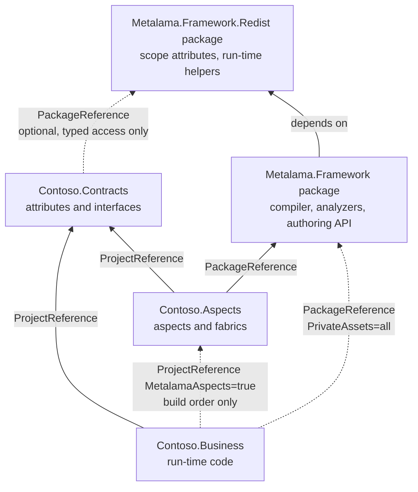

# Aspects projects

This document explores a design in which the aspects and fabrics of a solution live in a project that the
business code consumes as a build-only project reference, so that the business assemblies and packages depend on
no Metalama package other than a minimal `Metalama.Framework.Redist`. Such a project is called an
aspects project, after the aspects assembly of the package convention of section 6.2; it may contain aspects,
fabrics or both. It is a design proposal. Nothing described here is implemented. The file and
line references describe `develop/2027.0` in October 2026.

## 1. The problem

A project that applies aspects today references the `Metalama.Framework` package, and that reference has two
consequences for the shipped product.

The first consequence is a run-time dependency on the whole framework assembly. The `Metalama.Framework` package
has no `lib` assets of its own (`Metalama.Framework.Package/Metalama.Framework.Package.csproj`,
`IncludeBuildOutput=false`), but it depends on `Metalama.Framework.Redist` with every asset included, and
`Metalama.Framework.Redist` is `Metalama.Framework.dll` itself (`Metalama.Framework/Metalama.Framework.csproj:5`).
That assembly carries the whole aspect, template, code model and fabric application programming interface. It is
copied to the output directory and becomes a dependency of any package produced from the project. The documented
mitigation, `PrivateAssets="all"` on `Metalama.Framework` plus a direct reference to `Metalama.Framework.Redist`
(`Metalama.Documentation/content/conceptual/aspects/distributing.md`), removes the build assets from consumers but
keeps the run-time dependency.

The second consequence is that the dependency cannot be removed by stripping the output assembly. The
`RunTimeAssemblyRewriter` (`Metalama.Framework.Engine/CompileTime/RunTimeAssemblyRewriter.cs:331-335`) replaces the
bodies of compile-time-only members with a `throw` statement but removes no type. Aspect classes stay in the
assembly, derive from `Metalama.Framework` base types, carry `[CompileTime]` or `[RunTimeOrCompileTime]`, and
receive `[CompiledTemplate]` on their non-public templates (`RunTimeAssemblyRewriter.cs:418-510`). These types are
part of the public surface of the assembly, because business code applies them as custom attributes, so removing
them would change the public application programming interface. The comment at `RunTimeAssemblyRewriter.cs:83-85`
records this limit: private compile-time code could be stripped, accessible compile-time metadata must remain.

The root cause is that one project holds both the run-time code and the aspects that transform it. As long as the
aspect classes are custom attributes applied in the same assembly, the assembly has to contain them.

GitHub issue metalama/Metalama#132 is the user-facing form of this problem: a developer wants a development-only
dependency on Metalama. The answer at the time was a conditional `PackageReference`, which is not a design.

## 2. History: the `Metalama.Framework.RunTime` package

The run-time helpers of the framework were a separate package once. Commit `ba305d2d4b` (October 2023, 2023.4)
moved `Metalama.Framework/RunTime` (`RunTimeAspectHelper`, `FieldOrPropertyInfo`, `ReflectionHelper`,
`AsyncEnumerableList`) to a repository of its own, published as `Metalama.Framework.RunTime`, and made both
`Metalama.Framework` and `Metalama.Framework.CompileTime` reference the package. The reference assembly locator
added the package to its generated project so that the compile-time compilation could resolve it. The README of
the folder at the time read: "This namespace contains types that can be used at run time only. Other namespaces
are compile-time only. We should probably split these in two projects."

Commit `90dcdff778` (January 2025, 2025.1, issue 35674) merged the package back into `Metalama.Framework.dll`,
removed the dependency from `Directory.Packages.props`, `eng/src/Program.cs`, the reference assembly locator and
the package README. Since then the `Metalama.Framework.RunTime` namespace has grown: `AspectGeneratedAttribute`,
`CallSiteHelper`, `AsyncEnumerableArray`, the `Events` types and the `Initialization` types were added inside
`Metalama.Framework.dll` (`Metalama.Framework/RunTime`).

This proposal recreates that package, as a project of this repository rather than a separate repository, under
the name `Metalama.Framework.Redist`, which today names the whole framework assembly and is redefined (section
6.2), and gives it one more responsibility: it defines the scope attributes. Section 6.3 details the content.

## 3. Goal and non-goals

The goal is a project topology in which:

- the business project references, at run time, no Metalama assembly other than `Metalama.Framework.Redist.dll`,
  which is small, has no dependency, contains no compile-time surface, and does not replace the compiler;
- the package produced from the business project depends on `Metalama.Framework.Redist` only, and only when the
  business code or the woven code uses one of its types;
- the aspects are compiled in a separate project that the business project references as a build-only project
  reference, so that MSBuild builds the aspects project first and never passes its output to the compiler of the
  business project or copies it to the output directory;
- the contract between the two, namely the custom attributes and interfaces that the business code uses and the
  aspects react to, lives in a third project that references nothing from Metalama, or only
  `Metalama.Framework.Redist` when it opts into typed compile-time access to its types;
- the contracts project may target any framework and carry any dependency, because it may be a whole application
  framework rather than a thin set of attributes, and the aspects project targets whatever the contracts project
  requires;
- a fabric in the aspects project selects the declarations that carry the contract attributes and adds aspects to
  them, passing the attribute to the aspect;
- the configuration of the business project is two lines: a package reference and a project reference.

The following are not goals:

- Removing `Metalama.Framework.dll` from projects that keep the current topology. The current topology stays
  supported and unchanged.
- Flowing aspects from the business project to the projects that reference it. The consumers of the business
  project are not built with Metalama. Inheritable aspects and transitive fabrics stop at the business project.
- Removing the dependency on `Metalama.Framework.Redist` as well. A design with no run-time package at all was
  explored first and is recorded in section 10. It requires a polyfill of the scope attributes in every contracts
  project and a per-feature list of what woven code may not use. The restored package removes both costs at the
  price of one small dependency.

## 4. Proposed topology



The solid edges are ordinary compile references. The two dotted edges from the business project differ. The
project reference to the aspects project adds nothing to the compilation of the business project and nothing to
its output directory. The package reference to `Metalama.Framework` is private, so it flows to no consumer,
but it brings `Metalama.Framework.Redist.dll` into the compilation and the output directory of the business
project through its dependency (section 6.2). The aspects project must be built before the business project and
must not reference it, because the aspects project is an input of the build of the business project.

### 4.1. The contracts project

The contracts project is any class library. It declares the custom attributes that business code applies, for
example `[Log]` or `[Cached]`, and the interfaces or options types that both sides use. It may be a thin set of
attributes, or it may be a thick application framework targeting `net10.0` only, with heavy dependencies, in
which the attributes are a small part. The contracts project is not built with Metalama: it has no
`Metalama.Framework` reference, so the compiler is the standard one and no analyzer runs.

```csharp
namespace Contoso.Contracts;

[AttributeUsage( AttributeTargets.Method )]
public sealed class LogAttribute : Attribute
{
    public LogAttribute( string? category = null ) => this.Category = category;

    public string? Category { get; }
}
```

The aspects project reads the attributes of the contracts assembly in one of two ways, and the choice is per
type:

- Through the code model, as `IAttribute`. The attribute type is an ordinary run-time type. The fabric selects
  declarations by `typeof(LogAttribute)` and reads the arguments through `IAttributeData` and
  `TryGetArgumentValue<T>` (`Metalama.Framework/Code/AttributeExtensions.cs:38-116`). Nothing of the contracts
  assembly is loaded into the compile-time domain, so the contracts assembly may have any target framework and
  any dependency. This is the default path and it works with a contracts project that references nothing from
  Metalama.
- As a constructed instance, through `Construct<LogAttribute>()`. The attribute type is marked
  `[RunTimeOrCompileTime]` from `Metalama.Framework.Redist`, and the contracts assembly is loaded into the
  compile-time domain. The domain runs inside the compiler host, which is a .NET Framework 4.7.2 process in
  Visual Studio and in desktop MSBuild (`platform-support.md`, `Desktop=net472`), so this path requires the
  contracts assembly to be loadable there: `netstandard2.0`, with dependencies that the domain can load. This is
  the same constraint as for `MetalamaCompileTimeAssembly` today (`compile-time-target-frameworks.md`), and it is
  an opt-in for thin contracts projects that want typed access.

The second path is a convenience, not a requirement. A thick contracts assembly uses the first path and loses
nothing except the typed `LogAttribute` instance inside the fabric.

A third path exists for a contracts project that its author builds with Metalama: with `Metalama.Framework`
as a private reference and `Metalama.Framework.Redist` as its only run-time reference, Metalama extracts the
`[RunTimeOrCompileTime]` types of the project into its embedded compile-time project, and the business project
recompiles those sources as it does for any referenced compile-time project. Only the shared types are
extracted, so the project may be as thick as it likes at run time and nothing is loaded from its assembly in the
compile-time domain. This is how the caching run-time packages of `Metalama.Patterns` already work, and it is
the recommended path for Metalama's own run-time packages. The engine already embeds the compile-time project
of a project that has no aspect class of its own: the only remaining condition is the marker reference of
section 6.4, which becomes `Metalama.Framework.Redist.dll` and which every project built with the `Metalama.Framework`
package references. The [Patterns study](aspects-projects-patterns-study.md), gap 4, records the verification.

### 4.2. The aspects project

The aspects project is an ordinary Metalama project. It references `Metalama.Framework`, references the contracts
project, and is compiled by Metalama, so its output embeds the `Metalama.CompileTimeProject.zip` resource with the
compile-time sources and the manifest (`Metalama.Framework.Engine/CompileTime/CompileTimeConstants.cs:23`). The
run-time shape of its output assembly is irrelevant: no project ever compiles against it and no process ever
loads it as a run-time assembly. Only the embedded resource is consumed.

The aspects project targets whatever the contracts project requires, for example `net10.0` when the contracts
project is a `net10.0` application framework. Its target framework does not constrain the compile-time code,
because the compile-time compilation always targets `netstandard2.0` and is extracted from the sources
(`compile-time-target-frameworks.md`); it only constrains which target frameworks of the business project can
consume it, through the usual nearest-framework negotiation of project references.

The entry point is a `TransitiveProjectFabric`, because a `ProjectFabric` amends the project that declares it
(`Metalama.Framework/Fabrics/ProjectFabric.cs:44-53`), and the aspects project contains no business code. A
transitive fabric runs in every project that consumes the aspects project
(`Metalama.Framework.Engine/Fabrics/FabricManager.cs:53-62`), which in this topology is the business project.

```csharp
using Contoso.Contracts;
using Metalama.Framework.Code;
using Metalama.Framework.Fabrics;

namespace Contoso.Aspects;

public sealed class Fabric : TransitiveProjectFabric
{
    public override void AmendProject( IProjectAmender amender )
    {
        // Code model path: works with any contracts assembly.
        amender
            .SelectDeclarationsWithAttribute( typeof(LogAttribute) )
            .AddAspect( ( method, attribute ) => new LogAspect( attribute.GetArgumentValue<string>( "category" ) ) );
    }
}
```

`typeof(LogAttribute)` is legal in compile-time code even though `LogAttribute` is a run-time type: the compile-
time code rewriter replaces it with a `TypeOfResolver.Resolve` call that produces a `CompileTimeType` mock from
the metadata name (`Metalama.Framework.Engine/CompileTime/TypeOfRewriter.cs:30-69`), so the type is never
loaded. Member access on the type, such as `attribute.Category`, is not legal in compile-time code, which is why
the argument is read by name. With a thin contracts project that opted into `[RunTimeOrCompileTime]`, the same
fabric can use the typed overload instead:

```csharp
amender
    .SelectDeclarationsWithAttribute<LogAttribute>()
    .AddAspect( ( method, attribute ) => new LogAspect( attribute.Category ) );
```

The aspect classes themselves are unchanged. They derive from the usual base classes. No business code can apply
them as attributes, because the business project does not see the assembly. Section 7 describes the query
extensions used above.

### 4.3. The business project

```xml
<Project Sdk="Microsoft.NET.Sdk">

  <ItemGroup>
    <PackageReference Include="Metalama.Framework" Version="2027.0.x" PrivateAssets="all" />
    <ProjectReference Include="../Contoso.Contracts/Contoso.Contracts.csproj" />
    <ProjectReference Include="../Contoso.Aspects/Contoso.Aspects.csproj" MetalamaAspects="true" />
  </ItemGroup>

</Project>
```

`Metalama.Framework` is the package of today, with its run-time assembly inside it instead of in a dependency
(section 6.2). The business project references it with `PrivateAssets="all"`, so that nothing of it flows to the
consumers of the business project. The `developmentDependency` flag of a package only changes what
`dotnet add package` writes into the project file; for a reference written by hand it changes nothing, as the
[NuGet experiment](aspects-projects-nuget-experiment.md) shows, so the documentation must tell users to write
`PrivateAssets="all"` themselves.

`Metalama.Framework.Redist` reaches the business project through `Metalama.Framework`, so woven code can
use any run-time helper without configuration. The output assembly references the run-time assembly only when
the woven code uses one of its types. A business project that is packed and whose assembly references the
run-time assembly must also provide the dependency through a non-private reference, either directly or through
the contracts project; section 6.2 explains why and describes the pack-time check that enforces it. A package
produced from the business project therefore depends on `Metalama.Framework.Redist` at most, and on nothing
else from Metalama. A business project whose contracts are thick and whose aspects emit no helper call depends
on nothing from Metalama at all.

`MetalamaAspects` is a new metadata of `ProjectReference` described in section 6.1.

The business code applies the contract attributes and nothing else:

```csharp
using Contoso.Contracts;

public class OrderService
{
    [Log( "Orders" )]
    public void PlaceOrder( Order order ) { /* ... */ }
}
```

## 5. What exists today and what is missing

| Need | Status today | Reference |
|---|---|---|
| A run-time package with the scope attributes and the helpers | Existed from 2023.4 to 2025.0 without the attributes; merged back since 2025.1. | Commits `ba305d2d4b` and `90dcdff778`; `Metalama.Framework/RunTime` |
| Build a project before another one without compiling against its output | Exists in MSBuild: `ProjectReference` with `ReferenceOutputAssembly="false"` and `OutputItemType`. Used in this repository for analyzers. | `Microsoft.Common.CurrentVersion.targets`, target `ResolveProjectReferences`; `Metalama.Framework.CompileTime/Metalama.Framework.CompileTime.csproj:39` |
| Pass a list of assembly paths from MSBuild to the engine | Exists: `MetalamaCompileTimeAssembly` and `MetalamaExtensionAssembly` items are converted into compiler-visible properties and parsed by `MSBuildProjectOptions`. | `Metalama.Framework.Package/build/Metalama.Framework.targets:70-74`; `Metalama.Framework.Engine/Options/MSBuildProjectOptions.cs:269-284` |
| Discover aspects and fabrics in an assembly that is not a compile reference | Missing. The repository builder walks `compilation.References` only. Extension assemblies load `PipelineExtension` and service factories only. | `Metalama.Framework.Engine/CompileTime/CompileTimeProjectRepository.Builder.cs:195-230`; `Metalama.Framework.Engine/Extensibility/ExtensionLoaderBase.cs:56-141` |
| Run the pipeline in a project with no reference to `Metalama.Framework.dll` | Missing. Three checks require the reference. | `Metalama.Framework.Engine/Pipeline/MetalamaProjectClassifier.cs:16-39`; `Metalama.Framework.Engine/CompileTime/CompileTimeCompilationBuilder.cs:869-879`; `Metalama.Framework.Engine/Pipeline/AspectPipeline.cs:137-180` |
| Resolve aspect and fabric types without a symbol in the business compilation | Partly exists. A referenced compile-time project can supply its own discovery compilation. Fabric drivers still resolve the fabric type in the run-time compilation. | `Metalama.Framework.Engine/Aspects/TemplateClassFactory.cs:60-83`; `Metalama.Framework.Engine/Fabrics/FabricDriver.cs:51-84` |
| Select declarations by a run-time-only attribute type and read its arguments without loading the type | Exists: `typeof(X)` in compile-time code becomes a `CompileTimeType` mock; `SelectDeclarationsWithAttribute(Type)`; `TryGetArgumentValue<T>`. | `Metalama.Framework.Engine/CompileTime/TypeOfRewriter.cs:30-69`; `QueryExtensions.cs:64-69`; `AttributeExtensions.cs:38-116` |
| Use a `[RunTimeOrCompileTime]` type from a non-Metalama assembly in compile-time code | Partly exists through `MetalamaCompileTimeAssembly`, with hard-coded paths and a repetition in every consuming project. Classification by attribute already works for referenced types. | `Metalama.Documentation/content/conceptual/aspects/templates/template-compile-time.md:167`; `SymbolClassifier.cs:727` |
| Construct an attribute instance from an `IAttribute` | Exists: `IAttribute.Construct<T>()` and `TryConstruct`, which require the attribute type in a compile-time project. | `Metalama.Framework/Code/AttributeExtensions.cs:126-162`; `Metalama.Framework.Engine/CompileTime/AttributeDeserializer.cs:63-91` |
| Select declarations by attribute in a fabric | Exists: `SelectDeclarationsWithAttribute<TAttribute>(predicate)`. The attribute instance is not passed to `AddAspect`. | `Metalama.Framework/Fabrics/QueryExtensions.cs:49-69`; `Metalama.Framework/Aspects/AspectQueryExtensions.cs:80-240` |
| A package with the build assets of Metalama and no run-time asset | Missing. `Metalama.Framework` bundles the analyzers, the build files and the dependency on `Metalama.Framework.Redist`. | `Metalama.Framework.Package/Metalama.Framework.Package.csproj:58-72` |

## 6. Mechanism

### 6.1. MSBuild: the `MetalamaAspects` metadata of `ProjectReference`

The user marks an ordinary `ProjectReference` with `MetalamaAspects="true"`, and the Metalama build files
rewrite it into the build-only form that MSBuild already understands:

```xml
<!-- Metalama.Framework.targets -->
<ItemGroup>
  <ProjectReference Update="@(ProjectReference)"
                    Condition="'%(ProjectReference.MetalamaAspects)'=='true'"
                    ReferenceOutputAssembly="false"
                    OutputItemType="MetalamaAspectsAssembly"
                    Private="false" />
</ItemGroup>

<Target Name="ExportMetalamaAspectsAssemblies"
        DependsOnTargets="ResolveProjectReferences"
        BeforeTargets="GenerateMSBuildEditorConfigFileCore">
  <PropertyGroup>
    <MetalamaAspectsAssemblies>@(MetalamaAspectsAssembly->'%(FullPath)', ',')</MetalamaAspectsAssemblies>
    <MetalamaAspectsProjectFiles>@(MetalamaAspectsAssembly->'%(MSBuildSourceProjectFile)', ',')</MetalamaAspectsProjectFiles>
  </PropertyGroup>
</Target>
```

`MetalamaAspectsAssemblies` is declared as a `CompilerVisibleProperty`, like `MetalamaCompileTimeAssemblies`, and
read by a new `MSBuildProjectOptions.AspectsAssemblies` member. The path validation at
`Metalama.Framework.targets:253-266` applies, because `,` and `|` are the separators of the property.

The semantics of `ReferenceOutputAssembly="false"` with `OutputItemType` are verified in the common targets of the
.NET 10 SDK (`Microsoft.Common.CurrentVersion.targets`, target `ResolveProjectReferences`):

- On the command line, the `MSBuild` task builds the referenced project and writes its target outputs into the
  item named by `OutputItemType`; `_ResolvedProjectReferencePaths` receives nothing, so the compiler gets no
  reference and nothing is copied to the output directory.
- Inside Visual Studio, the same target calls `GetTargetPath` on the referenced project, which Visual Studio has
  already built in dependency order, and writes the result into the same item. Visual Studio honours
  `ReferenceOutputAssembly="false"` project references for build ordering.
- The output items carry the `MSBuildSourceProjectFile` metadata, which section 6.7 uses.

The target framework of the aspects project is negotiated as for any project reference: MSBuild selects the
nearest compatible target framework of the aspects project for each target framework of the business project, and
fails when there is none. The aspects project therefore targets what its contracts require, `net10.0` for a
`net10.0` application framework, or `netstandard2.0` when it has no such constraint. The item transform copies
the other metadata of the reference, so a user can set `SetTargetFramework` on the same `ProjectReference` when
the default selection is not the intended one. When the aspects project multi-targets and several of its target
frameworks are consumed by a multi-targeted business project, the business project gets one compile-time project
per pair, which `compile-time-target-frameworks.md` already describes for ordinary references.

Metadata on `ProjectReference` is preferred over a dedicated item for two reasons. The reference stays a
`ProjectReference`, so Visual Studio shows it in the project dependencies and orders the build by it without
help, and the user keeps every other metadata of a reference. The name matches the aspects assembly of the
package convention, `X.Aspects.dll` (section 6.2), so a user meets one word for the assembly a library ships and
the project a user writes. Two other names were considered. "Compile-time-only reference" describes what is
consumed but not that the referenced project acts on the referencing one. "Amender project", after
`IProjectAmender`, was the name of an earlier draft; it is more precise for a project of fabrics only, and it was
dropped because it introduced a second word for what the aspects assemblies already name, and because an
aspects assembly may itself contain fabrics only.

### 6.2. Packaging

The `Metalama.Framework` package today ships three things (`Metalama.Framework.Package.csproj:33-82`): the
analyzers in `analyzers/dotnet/cs` (the compiler extension with the embedded engine, the editor extensions and the
`[Durable]` analyzer), the `build` and `buildTransitive` files, and the dependencies on `Metalama.Framework.Redist`
with every asset and on `Metalama.Compiler` with `Build` and `Analyzers` excluded. `Metalama.Framework.Redist` is
the whole `Metalama.Framework.dll`.

The proposal follows one naming convention for every aspect library. Three packages share one aspects
assembly and differ by how it is consumed:

| Package | Content | Dependencies | Consumed by |
|---|---|---|---|
| `X.Redist` | `X.Redist.dll`: the attributes that business code applies, the run-time helpers, the shared `[RunTimeOrCompileTime]` types. It references `Metalama.Framework.Redist.dll` when it uses the scope attributes or the helpers, and never `Metalama.Framework.dll`. | `Metalama.Framework.Redist` | The business project, as an ordinary reference. It flows to the consumers of the business project. |
| `X.Compiler` | `metalama/<tfm>/X.Aspects.dll`, registered by the `buildTransitive` props of the package as a `MetalamaAspectsAssembly` item (section 6.1). No `lib/` folder: the assembly is never a compile reference nor a run-time asset, and the engine loads it during compilation. | `X.Redist`, with an exact version, because the two assemblies are built together. Nothing from `Metalama.Framework`. | The business project. The project references `Metalama.Framework` itself, privately; the props of the package report an error when the Metalama targets are not imported. |
| `X` | `lib/<tfm>/X.Aspects.dll`, the same assembly as a compile reference, so that a fabric or configuration code compiles against `ConfigureX` and the options. | `X.Redist`, `Metalama.Framework` flowing | A project that writes compile-time code against the library: the user's own aspects project, or a classic Metalama project that keeps today's experience. |

The name of the second package says what distinguishes it from the third, which carries the same assembly: not
its content, but the host that consumes it. It is the part of the library that runs inside the compiler, in the
family of analyzers and source generators, which the ecosystem ships as packages that the compiler loads and
nothing references. `DevOnly` and `CompileTime` were considered. The first says less, since a build tool or a
test helper is development-only too; the second collides with "compile-time project", an engine term, and with
the `MetalamaCompileTimeProject` property. The assembly inside the last two packages keeps the name
`X.Aspects.dll`, named for its content, and the project form keeps "aspects project" (section 6.1).

The same assembly in two packages is legitimate for NuGet, and the engine deduplicates by assembly identity
when a project reaches it both as a reference and as a registered item. The reference closure of the aspects
assembly is resolved through the package graph: when the aspects of `X` use `Metalama.Extensions.DependencyInjection`,
`X.Compiler` depends on `Metalama.Extensions.DependencyInjection.Compiler`, whose props register that assembly
too, and the engine binds among the registered assemblies and the references of the business project. The
`Metalama.Framework.dll` that the aspects assembly references is a compile reference of every project that
references `Metalama.Framework`, privately or not.

`X.Compiler` flows by default. A business project references it as an ordinary dependency, so that the
consumers of the business package restore it too. The package has no `lib/` and no run-time asset, so a
consumer gets nothing in its compilation or its output directory; it gets the props, which register the aspects
assembly. A consumer that builds with Metalama then has the aspects of `X` with no action, and an inheritable
aspect or a transitive fabric that the business project exposes reaches the consumer as it does today. In a
consumer that does not build with Metalama the item is inert, and the props stay silent, because only the
requirements resource of section 6.8 knows whether that consumer needed the aspects. Inheritance is the common
case, not the edge case: every contract aspect is inheritable by default, so a consumer that overrides a method
with a `[NotNull]` parameter must run the contracts aspects or its override silently loses the contract. Flowing
by default is what keeps that working. The package is therefore not marked `developmentDependency`, so that
`dotnet add package` writes an ordinary reference. A library author who exposes nothing to consumers may make
the reference private; the pack-time check below warns when that is wrong.

The business package then depends on `X.Redist`, `X.Compiler` and, through them, `Metalama.Framework.Redist`:
nothing with run-time code from Metalama, and no compiler. The earlier form of the reference,
`PrivateAssets="all" ExcludeAssets="compile;runtime"` on a package with a `lib/` folder, is not needed, because
`X.Compiler` has no `lib/` folder.

The [Patterns study](aspects-projects-patterns-study.md), section 3, applies the convention to the pattern
libraries. The framework itself needs two packages only:

| Package | Content | Dependencies | Flags |
|---|---|---|---|
| `Metalama.Framework.Redist` (redefined) | `Metalama.Framework.Redist.dll`: the scope attributes and the run-time helpers (section 6.3); the `buildTransitive` targets and the task of the consumer requirements check (section 6.8) | `Microsoft.Bcl.AsyncInterfaces` for `netstandard2.0` only; none for `net10.0` | none |
| `Metalama.Framework` | `lib/Metalama.Framework.dll`, the aspect-authoring application programming interface, with type forwarders to the run-time assembly; the analyzers; the `build` and `buildTransitive` files | `Metalama.Framework.Redist` with every asset, `Metalama.Compiler` (as today), `Microsoft.CSharp` | as today |

Earlier drafts had two more framework packages, `Metalama.Framework.Build` (the analyzers and build files alone,
as a development dependency) and `Metalama.Framework.Aspects` (the authoring assembly alone). Both were dropped.
The first existed for the `developmentDependency` default, which the experiment showed to be inert for a
hand-written reference, and to keep the authoring assembly out of business projects, which the pack-time check
below and the diagnostic pass of section 6.6 already guarantee. The second would have served a library that
needs the authoring assembly at run time without the compiler, which is today's `Metalama.Framework.Redist`
usage; under the convention a library's run-time assembly is `X.Redist.dll`, which references
`Metalama.Framework.Redist.dll` only, and no such package is needed. A business project therefore references
`Metalama.Framework` with `PrivateAssets="all"` and compiles against the authoring assembly, which the compiler
drops from the output when nothing uses it; the cost is an assembly in the output directory that nothing loads.
A business project may legitimately contain compile-time code of its own, so the authoring assembly is not a
forbidden surface there, unlike the aspects assembly of a library, which is why `X.Compiler` has no `lib/`
folder while `Metalama.Framework` has one.

A project that references `Metalama.Framework` gets the analyzers, the build files and the authoring assembly
from it, and the run-time assembly through its dependency. The `PackageReference Update="Metalama.Framework" PrivateAssets="none"` at
`build/Metalama.Framework.props:4` keeps flowing the build assets to the consumers of aspect libraries. The
`buildTransitive` files of `Metalama.Compiler` keep flowing through the `Metalama.Framework` package, because
`ExcludeAssets="Build"` excludes the `build` folder and not the `buildTransitive` folder, which is what the current
nuspec relies on.

The convention breaks one documented usage. `Metalama.Framework.Redist` is today the whole `Metalama.Framework.dll`,
and `distributing.md` tells a library author to reference `Metalama.Framework` privately plus
`Metalama.Framework.Redist`, so that consumers get the authoring assembly at run time without the compiler. After
the change, such a library gets only the minimal assembly from `Metalama.Framework.Redist`, and its aspect classes
no longer find `Metalama.Framework.dll` in consumers. There is no substitute package: the migration for such a
library is to split into the three packages of the convention, or to reference `Metalama.Framework` without
`PrivateAssets`, which flows it to consumers as it did before the author followed `distributing.md`. This is a
breaking change and is accepted for a major version; the release notes and `distributing.md` carry the two
options.

The run-time package is a project of this repository, `Metalama.Framework.Redist`, targeting `netstandard2.0`
and `net10.0` like `Metalama.Framework`, referenced by `Metalama.Framework` and by `Metalama.Framework.CompileTime`
as a project reference. The 2023 split used a separate repository with its own versioning, which the 2025 merge
undid. A project in this repository shares the version of the product, which is simpler, and the package is small
enough that the version churn costs nothing. The reference assembly locator needs no change for the package,
because it obtains `Metalama.Framework.dll` and its dependencies through the `Metalama.Framework` package of its
generated project (`Metalama.Framework.Engine/CompileTime/CompileTimeAssemblyLocator.cs`).

The `Metalama.Framework` package is what makes a project a Metalama project. A business project references
it directly and privately. Its consumers see no Metalama package other than the run-time package, which is the
desired outcome and is also a constraint: a transitive fabric or an inheritable aspect that the business project
would expose reaches its consumers only if they build with the same aspects, which the consumer requirements
check of section 6.8 enforces.

The `Metalama.Framework` package depends on the run-time package so that every Metalama project compiles against
`Metalama.Framework.Redist.dll` and copies it to its output directory without configuration. Woven code can then
use any run-time helper, and an application needs nothing beyond the two lines of section 4.3. The compiler drops
the reference from the output assembly when nothing uses it, so a business assembly references the run-time
assembly only when its woven code needs it. The file is copied to the output directory in every case, because
copy-local does not depend on whether the compiler kept the reference; the design accepts this, since the file is
small and a packed library ships only its own assembly.

This dependency has one consequence for projects that are packed. NuGet pack writes into the nuspec the direct
package references of the project that are not private, and nothing else; a dependency reached only through a
private reference is omitted. The reference to `Metalama.Framework` is private, so `Metalama.Framework.Redist` does not appear in the nuspec of
a business package unless the project references it directly as well, or reaches it through a project reference
to a contracts project that does. A business package whose assembly references the run-time assembly and whose
nuspec does not declare it would fail on the consumer's machine, with no diagnostic at build time. The `Build`
targets therefore add a check before `GenerateNuspec`: when the output assembly references
`Metalama.Framework.Redist` and no `PackageReference` or `ProjectReference` of the project provides it without
`PrivateAssets="all"`, pack fails with an error that names the missing reference. The check reads the assembly
references of the built output, which `GetReferencedAssemblies` on a metadata reader gives for the cost of
opening the file. Adding the reference from the `Metalama.Framework` props instead is not an option: NuGet imports the props
of a package after restore, so a `PackageReference` declared there is not part of the restore graph.

The same check covers the opt-out of `X.Compiler`: when the output carries the consumer requirements resource of
section 6.8 and a package that the resource names is referenced with `PrivateAssets="all"`, pack warns that the
consumers of the package will have to add that reference by hand. A library that exposes nothing carries no
resource and gets no warning.

The alternative of keeping one package and referencing it with `ExcludeAssets="runtime;compile"` is rejected. The
asset flags of a direct reference apply to the direct package, and whether and how they apply to its dependencies
is a NuGet detail that users would have to get right in every project. A package whose name says what it is for
needs no such knowledge.

The run-time package takes the `Redist` name of the convention; an earlier draft restored the historical
`Metalama.Framework.RunTime` name, which was dropped so that the framework follows the same convention as the
libraries built on it.

### 6.3. The content of `Metalama.Framework.Redist`

The package contains two groups of types, both moved from `Metalama.Framework.dll` with their namespaces
unchanged and with `[TypeForwardedTo]` left behind in `Metalama.Framework.dll`, so that assemblies compiled
against an earlier `Metalama.Framework.Redist` keep loading against the new one.

The scope attributes, in `Metalama.Framework.Aspects`: `CompileTimeAttribute`, `RunTimeAttribute`,
`RunTimeOrCompileTimeAttribute`, `CompileTimeReturningRunTimeAttribute` and
`ForcedGenericRunTimeOrCompileTimeAttribute`, which are the attributes that `SymbolClassifier.GetTemplatingScope`
recognizes (`SymbolClassifier.cs:255-267`) and that a contracts project needs. `TemplateAttribute`,
`IntroduceAttribute` and `InterfaceMemberAttribute` are recognized by the same method but belong to aspect
classes, which always reference `Metalama.Framework`, so they stay where they are. The same group holds the
framework types that a run-time package needs in its own public surface: `ContractDirection`, a
`[RunTimeOrCompileTime]` enum used as a named argument of every contract attribute of `Metalama.Patterns.Contracts`,
and the analyzer annotations `[Durable]` and `[ImmutableType]` of `Metalama.Framework.Utilities`, which are placed
on run-time types. The rule is that a framework type which a run-time package exposes to its own users belongs to
the run-time package.

The run-time helpers, in `Metalama.Framework.RunTime`, which is the whole `Metalama.Framework/RunTime` folder:
`AspectGeneratedAttribute`, `AsyncEnumerableArray`, `AsyncEnumerableList`, `CallSiteHelper`,
`FieldOrPropertyInfo`, `ReflectionHelper`, `RunTimeAspectHelper`, the `Events` types (`EventBroker`,
`DelegateList`, `DelegateEventAdapter`, `IEventAdapter`, `EventBrokerServices`, `EventHandlerInvocationCallback`)
and the `Initialization` types (`IInitializable`, `InitializationContext`, `InitializationMetadata`,
`InitializationSlot`, `InitializationSlotFactory`, `InitializableExtensions`, `CallerIntent`).

Two rules keep the package minimal:

- A type goes into the package only when woven code references it, or when business or contract code must apply
  it. The engine emits references to every type in the second group (`AdviceImpl/Introduction/Constructors/IntroduceConstructorParameterAdvice.cs:229`,
  `AdviceImpl/Initialization/OnConstructedEpilogueEmitter.cs:217`, `Advising/TemplateBindingHelper.cs`,
  `Extensibility/CallSites/ExtensionTransformationFactory.ArgumentPlan.cs:328`, `Linking/InitializableTypeRegistry.cs`,
  `Linking/Substitution/EventRaiseBrokerCallSubstitution.cs`).
- The package has the smallest dependency set that its content allows, so that it never constrains the
  dependency graph of a business package. The `netstandard2.0` flavor of `Metalama.Framework.Redist` today
  depends on `Microsoft.Bcl.AsyncInterfaces`, `Microsoft.Bcl.HashCode`, `Microsoft.CSharp` and
  `System.Collections.Immutable`. The `AsyncEnumerable*` helpers need `IAsyncEnumerable<T>`, so the
  `netstandard2.0` flavor of the run-time package depends on `Microsoft.Bcl.AsyncInterfaces`, and that is its
  only package dependency. The `net10.0` flavor has none. The move itself needs two small edits, because two
  files carry a `using` for documentation references only: `AspectGeneratedAttribute.cs` imports
  `Metalama.Framework.Code` and `AsyncEnumerableArray.cs` imports `System.Collections.Immutable`; the
  documentation references are rewritten so that the new project compiles without those namespaces.

`IFieldOrProperty.ToFieldOrPropertyInfo()` returns `FieldOrPropertyInfo`, so `Metalama.Framework.dll` references
the run-time assembly, which is the same direction as in 2023.

### 6.4. Engine: compile-time projects from aspects assemblies

The repository builder (`CompileTimeProjectRepository.Builder.cs:195-230`) starts from the framework project and
loops over `runTimeCompilation.References`. The proposal adds a second loop over
`ProjectOptions.AspectsAssemblies`, which calls the existing `TryGetCompileTimeProjectFromPath`
(`CompileTimeProjectRepository.Builder.cs:355-486`) for each path. That method already handles an assembly with
an embedded `Metalama.CompileTimeProject.zip`: it reads the manifest, recompiles the sources into an
`ml!<name>_<hash>` assembly, and resolves the manifest references. The resulting projects are added to the
references of the compile-time project of the business project, so that:

- `FabricManager.ExecuteFabrics` (`FabricManager.cs:53-62`) finds the transitive fabrics of the aspects project;
- `TemplateClassFactory` (`TemplateClassFactory.cs:39-123`) finds the aspect classes in the closure;
- hierarchical options types are found as today.

The compile-time project of the business project is empty, because the project has no compile-time code, which
`CompileTimeCompilationBuilder` already supports when referenced projects exist
(`CompileTimeCompilationBuilder.cs:1180-1198`).

Three checks use a reference to `Metalama.Framework.dll` as the marker of a Metalama project. The marker
becomes `Metalama.Framework.Redist.dll`, which every project built with the `Metalama.Framework` package references through
the package dependency of section 6.2, whether it is a business project, an aspects project or a run-time
package built with Metalama. The `METALAMA` preprocessor symbol, which the build files define, stays as the
second half of the condition. The version of the framework is read from the identity of the `Redist`
assembly, which shares the version of the engine. A project that references the `Redist` package without
`Metalama.Framework` has neither the symbol nor the analyzers, and the engine never runs in it.

- `MetalamaProjectClassifier.TryGetMetalamaVersion` (`MetalamaProjectClassifier.cs:16-39`) requires the
  `METALAMA` preprocessor symbol and a referenced assembly named `Metalama.Framework`. The assembly name
  changes to `Metalama.Framework.Redist`.
- `CompileTimeCompilationBuilder.TryGetCompileTimeProject` (`CompileTimeCompilationBuilder.cs:869-879`) returns
  no project when no reference has the file name `Metalama.Framework`. The file name changes to
  `Metalama.Framework.Redist`.
- `AspectPipeline.TryInitialize` (`AspectPipeline.cs:165-180`) compares the referenced `Metalama.Framework`
  version with the engine version, and reports `MetalamaVersionNotSupported` when several versions are
  referenced or one is newer than the engine. The same comparison applies to the `Redist` assembly.

An earlier draft widened the condition to "references `Metalama.Framework.dll` or declares at least one aspects
assembly". The `Redist` marker is simpler, and it covers the run-time packages built with Metalama (section 4.1),
which declare no aspects assembly and reference no `Metalama.Framework.dll`.

The early exit of the pipeline when there is no aspect class (`AspectPipeline.cs:689-691`) does not prevent the
compile-time project of such a package from being embedded: `BoundAspectClasses` is the collection that
includes the three system aspect classes added at `AspectPipeline.cs:333-343`, so its count is never zero when
a compile-time project exists, and `ExecuteCoreAsync` adds the resource whenever the project is not empty
(`CompileTimeAspectPipeline.cs:306-309`). `RunTimeAssemblyRewriter` then stubs compile-time-only members only,
so the `[RunTimeOrCompileTime]` types of the package keep their bodies and the package is fully functional at
run time.

The compile-time compilation of the business project does not need the business project to reference
`Metalama.Framework.dll`. It references `CompileTimeAssemblyLocator.MetadataReferences`
(`CompileTimeCompilationBuilder.cs:473-481`), which is the fixed set that the locator obtains from its own
generated project, and that set contains `Metalama.Framework.dll` at the engine version.

Two resolutions of types as symbols of the business compilation need a different source, because the aspect
assembly is not a reference of that compilation:

- Aspect classes. `TemplateClassFactory` resolves each aspect type name with `GetTypeByMetadataName` in
  `item.Project.TemplateReflectionContext ?? this.CompilationContext` (`TemplateClassFactory.cs:60-66`), and
  `CompileTimeProject.TemplateReflectionContext` (`CompileTimeProject.cs:75`) comes from a
  `CacheableTemplateDiscoveryContextProvider`, which builds a discovery compilation from the portable executable
  references of the compilation with `MetadataImportOptions.All`
  (`CacheableTemplateDiscoveryContextProvider.cs:43-47`). For an aspects assembly, the provider is created with
  the references of the business compilation plus the aspects assembly itself and its reference closure. The
  aspect types then resolve in that discovery compilation without being visible to the business code.
- Fabrics. `FabricDriver.GetCreationData` (`FabricDriver.cs:51-84`) resolves the fabric type in the run-time
  compilation through the `ReflectionMapper`, and `ProjectFabricDriver` (`ProjectFabricDriver.cs:49-50,102`) uses
  the containing assembly of the fabric to compute the depth in the reference graph and to obtain the `IAssembly`
  of the code model. Both need a branch for a fabric whose assembly is not referenced: the symbol comes from the
  same discovery compilation as above, and the depth is one more than the depth of the business project, which is
  the depth a direct reference would have. The code model `IAssembly` that `IFabricInstance` exposes for such a
  fabric is a declaration of the discovery compilation and is not reachable from the business compilation
  through `ICompilation.ReferencedAssemblies`. Whether that matters to any public contract of `IFabricInstance`
  is an open question (section 9).

Aspect instances are created through the fabric and the aspect class only. `CompilationAspectSource`
(`Metalama.Framework.Engine/Aspects/CompilationAspectSource.cs:73-133`), which turns custom attributes whose
class is an aspect class into aspect instances, finds nothing in this topology and needs no change.

### 6.5. Engine: contract types at compile time

The aspects project uses contract types in compile-time code, in one of the two ways of section 4.1.

#### The code model path

The fabric names the attribute type through `typeof(LogAttribute)`, which the compile-time code rewriter turns
into a `TypeOfResolver.Resolve` call (`ProduceCompileTimeCodeRewriter`, `TypeOfRewriter.cs:30-69`), and
`ReflectionMapper.GetTypeSymbol` accepts the resulting `CompileTimeType` mock
(`Metalama.Framework.Engine/CodeModel/Helpers/ReflectionMapper.cs:87-98`). `SelectDeclarationsWithAttribute(Type)`
(`QueryExtensions.cs:64-69`) and `IAttributeCollection.OfAttributeType(Type)` resolve the mock against the
business compilation, where the contracts assembly is an ordinary reference. The arguments are read from
`IAttributeData.ConstructorArguments` and `NamedArguments`, or through `TryGetArgumentValue<T>`, which matches
constructor parameters and named arguments by name without constructing anything
(`AttributeExtensions.cs:38-116`).

This path needs no engine change. The contracts assembly stays a run-time-only reference of the business
compilation; the compile-time compilation never references it and the compile-time domain never loads it. The
restriction is that compile-time code cannot access members of the attribute type, because
`TemplatingCodeValidator` rejects the use of a run-time-only type in compile-time code, so the fabric reads
arguments by name. Section 9 records a possible future convenience for this.

#### The typed path

The fabric uses `LogAttribute` as a type: generic `SelectDeclarationsWithAttribute<LogAttribute>()`,
`Construct<LogAttribute>()`, or a typed constructor parameter of the aspect. Three things must then hold for the
contract type.

The type must be classified as run-time-or-compile-time in the aspects project. `SymbolClassifier` classifies a
referenced type from its own attributes (`SymbolClassifier.cs:727`, through `GetScopeFromAttributes`), which it
matches by simple name (`SymbolClassifier.cs:255-267`). With the real attribute from the run-time package, both
the name and the full name match, so this works as is. `GetAssemblyScope` (`SymbolClassifier.cs:269-295`)
deliberately ignores an assembly-level `[RunTimeOrCompileTime]`, because "we must take the decision for each
type", so the attribute goes on each contract type and not on the assembly.

The type must be referenced by the compile-time compilation of the aspects project, and later by the compile-time
compilation of the business project when it recompiles the embedded sources. The compile-time compilation
references the fixed set plus the referenced compile-time projects (`CompileTimeCompilationBuilder.cs:473-481`),
and the contracts assembly is in neither. Today the only way to add it is a `MetalamaCompileTimeAssembly` item
with a hard-coded output path, repeated in the business project. The proposal is a third kind of compile-time
project, next to the transformed and the untransformed kinds: an assembly with no embedded resource and no
`[assembly: CompileTime]`, but with at least one type marked `[RunTimeOrCompileTime]`, is loaded as a
"foreign compile-time assembly". It is referenced by the compile-time compilation as is, loaded into the
compile-time domain as is (`CompileTimeProject.TryCreateUntransformed`, `CompileTimeProject.cs:337-459`, already
does both for the untransformed kind), and contributes no aspect, fabric or option type. `MetadataReader`
(`MetadataReader.cs:93-119`) gains a flag for the presence of the attribute on any type, which costs one pass over
the type definitions of the metadata. The run-time assembly itself is excluded from this kind: it is part of the
fixed reference set of every compile-time compilation.

The assembly must be loadable in the compile-time domain of every host, which includes the .NET Framework 4.7.2
hosts of the platform baseline. A `netstandard2.0` assembly with loadable dependencies qualifies. A `net10.0`
assembly does not, and the engine must report a clear diagnostic when an assembly marked
`[RunTimeOrCompileTime]` cannot be loaded, naming the code model path as the alternative, instead of failing
with a `FileLoadException` or `BadImageFormatException` from `domain.LoadAssembly`.

The type must be constructible by `AttributeDeserializer` (`AttributeDeserializer.cs:63-91`), which resolves the
attribute class through `ProjectSpecificCompileTimeTypeResolver` (`ProjectSpecificCompileTimeTypeResolver.cs:33-58`)
and that resolver asks the repository for the compile-time project of the containing assembly. With the contracts
assembly registered as a foreign compile-time assembly, `GetTypeOrNull` returns the type from the loaded
assembly and construction succeeds. Without this registration, `Construct<T>` reports LAMA0401.

The `SymbolClassifier` constructor (`SymbolClassifier.cs:152-160`) detects the framework through
`RunTimeOrCompileTimeAttribute` by full name, then resolves `TemplateAttribute` and `DeclarativeAdviceAttribute`
with an assertion that they exist. Once the scope attributes live in the run-time assembly, a business or
contracts project satisfies the first lookup and fails the assertion, so the two template attributes must become
optional in that constructor. `CompileTimeCodeFastDetector` (`CompileTimeCodeFastDetector.cs:20-75`) considers a
syntax tree only when it imports a `Metalama.Framework` namespace; a contracts project imports
`Metalama.Framework.Aspects` for the attribute, but the detector only runs in projects built with Metalama, which
the contracts project is not.

### 6.6. Engine: what woven code references in the business assembly

The transformed business assembly may reference `Metalama.Framework.Redist.dll`, which every Metalama project
references through the `Metalama.Framework` package (section 6.2), and must not reference `Metalama.Framework.dll`. With the
content of section 6.3, every type that the engine emits on its own is in the run-time assembly, and the helpers
that templates call explicitly (`ToFieldOrPropertyInfo()`, enumerable buffering through `meta.Proceed()`) are
too.

A safety net remains useful, because the inventory is maintained by hand and a template can reference any
run-time-or-compile-time type of `Metalama.Framework.dll` in a run-time expression. When the project has no
reference to `Metalama.Framework.dll`, the pipeline walks the symbols that the transformed syntax trees bind to,
after linking, and reports one diagnostic per distinct type of that assembly, with the location of the aspect
that introduced it. Without this pass, the compiler reports CS0012 ("the type is defined in an assembly that is
not referenced") against generated code, which the user cannot act on. The same pass is the test that keeps the
run-time package complete: a type that the pass reports in the test suite of this repository is a type that
belongs in the package.

### 6.7. Design time

Design-time support for aspects projects is a user story of its own (metalama/Metalama#2237). The first version of the aspects project
story works at design time with the aspects assembly as it was last built, which is the fallback described
below. The live-edit behaviour, in which an edit to an aspect is visible in the business project without a
build, is the subject of the separate story, and this section specifies it.

#### 6.7.1. What exists today for a referenced Metalama project

In the IDE, Roslyn hands the consuming compilation a `CompilationReference` for a project reference between two
projects of the same language. `CompileTimeProjectRepository.Builder` first asks `IUpstreamCompileTimeProjectProvider`
for the pipeline of the referenced project, found by the referenced compilation's `ProjectKey`, and reuses its
`CompileTimeProject` when the run-time identity matches (`CompileTimeProjectRepository.Builder.cs:279-313`, issue
#1611). Otherwise it builds a projection from the referenced compilation. A `ProjectKey` is the assembly name
plus a hash of the preprocessor symbols, which include the `METALAMA_PROJECT_<hash>` symbol that the build files
define (`Metalama.Framework.DesignTime/ProjectKeyFactory.cs:31-47`).

Change tracking is by project key. `ProjectVersion.ReferencedProjectVersions` is built from the
`CompilationReference`s of the compilation (`Pipeline/Diff/ProjectVersionProvider.Implementation.cs:185-192`).
`PipelineState.InvalidateCacheForNewCompilationAsync` treats a compile-time change in a referenced compilation as
a compile-time change of the current project (`DesignTimeAspectPipeline.PipelineState.cs:219-221`), which
discards the long-lived pipeline configuration. Pause and resume propagate through the event hub to every
pipeline whose `ReferencedProjectVersions` contains the key of the pipeline that changed status
(`DesignTimeAspectPipeline.cs:206-230`). A build of a project is noticed by that project's own pipeline through
its `MetalamaBuildTouchFile` watcher, which resumes the pipeline and raises `OnExternalBuildCompleted`
(`DesignTimeAspectPipeline.cs:310-350`).

#### 6.7.2. What an aspects project lacks

With `ReferenceOutputAssembly="false"`, the project system passes nothing to Roslyn: the business compilation has
neither a `CompilationReference` nor a `PortableExecutableReference` to the aspects project. The business
pipeline knows the aspects project through two strings of the analyzer configuration only: the output path
(`MetalamaAspectsAssemblies`) and the project file (`MetalamaAspectsProjectFiles`, from the
`MSBuildSourceProjectFile` metadata of the output item, section 6.1). Everything of section 6.7.1 keys on
`ProjectKey`, which the business pipeline cannot compute for a project it does not see.

#### 6.7.3. The fallback, which is the first version

The design-time pipeline reads `MetalamaAspectsAssemblies` like any other option and loads each file through
`TryGetCompileTimeProjectFromPath`, as the build does. The business project then sees the aspects assembly as it
was last built. Before the first build the file does not exist; the pipeline skips the entry with a trace and
reports nothing, as it does for a project where Metalama is not enabled
(`DesignTimeAspectPipelineFactory.cs:453-458`), rather than failing the initialization of the business pipeline.

A rebuilt assembly at the same path must be noticed. `TryGetPipeline` compares the paths of the metadata
references and the equality of the options (`DesignTimeAspectPipelineFactory.cs:213-292`); the aspects path is a
string in the options, so a rebuild changes nothing that the comparison sees. The business pipeline therefore
watches each aspects assembly for changes, in the manner of the touch-file watcher, and resets its state when
one changes. Whether the metadata cache of the repository, which records the timestamp of each file it reads,
already re-reads a changed file is to be checked during implementation; the watcher is needed in any case to
trigger the reset.

#### 6.7.4. Live editing, the separate story

The live-edit behaviour is rebuilt on top of the project file path, in four steps.

1. **A secondary index in `DesignTimeAspectPipelineFactory`**, from project file path and target framework to
   pipeline. Both are already in the options of every pipeline: `MSBuildProjectFullPath` is exported by
   Metalama.Compiler and `TargetFramework` by the .NET SDK. The business project exports, next to each project
   file, the target framework that the reference negotiated, read from the `SetTargetFramework` metadata of the
   resolved reference item, so that the pair resolves one pipeline of a multi-targeted aspects project. The
   property format is `path|targetFramework` per entry, with `,` between entries, as for the extension
   assemblies.
2. **A provider in the second discovery loop** of `CompileTimeProjectRepository.Builder` (section 6.4). For each
   aspects entry, the builder asks a new global service, `IAspectsProjectProvider`, implemented in the design-time
   assembly and absent in the build, for a live `CompileTimeProject`, found through the index with the readiness
   and identity guards of the #1611 branch: the pipeline exists, its configuration is ready, and the run-time
   identity of its compile-time project is the identity of the aspects assembly. When the provider returns
   nothing, the builder uses the file as in section 6.7.3.
3. **Invalidation.** The pipelines of the aspects projects must appear in the business pipeline's
   `ReferencedProjectVersions`, so that a compile-time change in an aspects project discards the business
   configuration, and so that pause and resume propagate. `ProjectVersionProvider` builds that dictionary from
   `CompilationReference`s only and gains a second source, the project versions of the aspects pipelines obtained
   through the factory index. Two cases need handling. If the aspects pipeline does not exist when the business
   pipeline starts, the business pipeline uses the file and must become dirty when the aspects pipeline later
   becomes ready, which means the factory records which business pipelines wait for which project file and
   raises the dirty notification when a matching pipeline reaches the ready status. And when the aspects
   pipeline is paused because its compile-time code changed, the business pipeline pauses with it and resumes
   with it, as a dependent of a referenced project does today.
4. **The dependency graph** that drives `OnOtherPipelineCompilationResultChanged`
   (`DesignTimeAspectPipeline.cs:170-200`) tracks which upstream documents the results of a project depend on,
   for run-time code of referenced projects. The business project depends on no run-time code of the aspects
   project, and every change that matters to it is a compile-time change, handled by step 3. The aspects
   project therefore does not participate in the dependency graph.

The design-time memory rules (`design-time-memory.md`) apply as they apply to `CompilationReference`s today: the
business `ProjectVersion` may hold the most recent version of each aspects project and nothing older, and the
pipeline configuration must not pin any compilation, including those of the aspects projects.

Steps 1, 2 and the watcher of section 6.7.3 are small and mirror existing code. Step 3 is the uncertain part and
is the gate of the story: it is prototyped first, in the design-time test harness, with an aspects project holding
a transitive fabric and a business project configured through the two options, and an assertion that an edit to
the fabric changes the output of the business project without a build. The claim of section 6.7.2 that the
project system passes nothing to Roslyn for a build-only reference is what `ResolveProjectReferences` implies and
must be confirmed by hand in Visual Studio, Rider and the C# Dev Kit, each of which has its own project system.

#### 6.7.5. Rejected alternative

Keeping a real `ProjectReference` during design-time builds only, so that Roslyn sees the aspects project as a
compilation reference, is rejected. The business project would then see the aspect types and
`Metalama.Framework.dll` in the editor and not in the build, and code that compiles in the editor would fail on
the command line.

### 6.8. Consumers of the business project and the transitive requirement

#### 6.8.1. The problem

A business project B that uses a library L whose aspects are inheritable, or whose fabrics are transitive, or
whose validators check references, produces an output that acts on its consumers: a project C that references B
must run those aspects on its own code. Today this works because `Metalama.Framework` flows to C as an ordinary
dependency. In the aspects topology, `Metalama.Framework` is private and nothing carries it to C, and NuGet has no way to say
"whoever consumes B must also build with these packages". The [NuGet experiment](aspects-projects-nuget-experiment.md)
establishes that none of the package-graph mechanisms can express it: `developmentDependency` does not make a
reference private, a dependency reached only through a private reference is absent from the nuspec, and an
exclusion of build assets on any intermediate reference removes the `buildTransitive` props of every package
below it. A requirement that must reach C therefore travels with the assembly of B, which is the one artifact
that reaches every consumer, from a package `lib/` folder and from a project `bin/` folder alike.

The output of B keeps what it carries today. The `Metalama.InheritableAspects.bin` resource
(`CompileTimeAspectPipeline.cs:333-351`) is written when the project has inheritable aspect instances, inheritable
options, annotations, transitive contributors or initializable types; a consumer that is not built with Metalama
ignores it, and a consumer that is built with the same aspects reference reads it. An earlier draft proposed to
omit it with a warning; the [Patterns study](aspects-projects-patterns-study.md), gap 7, explains why that was
wrong. The `Metalama.CompileTimeProject.zip` resource is not written for a project without compile-time code.

#### 6.8.2. The requirements resource

When the engine writes `Metalama.InheritableAspects.bin`, it knows what the consumer will need: the `Metalama.Framework`
package, and each aspects assembly whose aspect classes, fabrics or validators are the reason the manifest has
content. It writes that knowledge as a second managed resource, `Metalama.ConsumerRequirements.json`, next to
the manifest. The resource is JSON so that a build task can read it with no dependency on the engine:

```json
{
  "version": 1,
  "severity": "warning",
  "producer": "Contoso.Business",
  "requirements": [
    {
      "assembly": "Metalama.Patterns.Contracts.Aspects",
      "package": "Metalama.Patterns.Contracts.Compiler",
      "reasons": [ "inheritable-aspects" ]
    },
    {
      "assembly": "Contoso.Aspects",
      "project": "src/Contoso.Aspects/Contoso.Aspects.csproj",
      "reasons": [ "transitive-fabric" ]
    }
  ]
}
```

- `version` is the format version, for the reader to refuse a newer format rather than misread it.
- `severity` is `warning` or `error`, from the producer's property of section 6.8.4.
- `producer` is the assembly name of B, for the message.
- Each requirement names the aspects assembly by its assembly name, which is what the check compares, plus
  the way to obtain it when known: the package identifier, from the `PackageId` metadata that the props of a
  `Compiler` package set on its `MetalamaAspectsAssembly` item, or the project file, relative to the solution directory, from the
  `MetalamaAspectsProjectFiles` property for a project reference. Neither is required; the message is less
  helpful without them.
- `reasons` is a list of `inheritable-aspects`, `transitive-fabric`, `reference-validators` and
  `initializable-types`, computed from the content of the manifest; it is informational.

The requirement for the `Metalama.Framework` package is implicit: a consumer that must run any aspects assembly must build
with Metalama, so the check first verifies that the `Metalama.Framework` targets are imported.

The engine computes the requirements from its own manifest only. A consumer C that is itself built with
Metalama and re-exposes aspects it inherited from B writes its own resource from its own manifest, so a chain
of business projects needs no copying of requirements from one to the next.

#### 6.8.3. The check in the `Redist` targets

The `Redist` package is the one whose `buildTransitive` props and targets reach every consumer of a business
package, through the default `exclude="Build,Analyzers"` of a dependency, as the experiment measured. `Redist`
therefore ships a targets file and a small task assembly, `Metalama.Framework.Redist.Tasks.dll`, for `net472`
and the current .NET, in the manner of the tasks that `Metalama.Compiler` ships. The targets run after
`ResolveAssemblyReferences` and before `CoreCompile`:

1. The task opens every item of `@(ReferencePath)` with `System.Reflection.Metadata`, reads the manifest resource
   table, and parses `Metalama.ConsumerRequirements.json` when present. It never loads an assembly. It uses
   `@(ReferencePath)` and not `@(ReferencePathWithRefAssemblies)`, because the latter points at the reference
   assembly of a project reference, under `obj/<configuration>/<tfm>/ref/`, which does not carry managed
   resources, while the former points at the implementation assembly. The cost is one metadata open per
   reference; a reference whose `NuGetPackageId` starts with `System.` or `Microsoft.` is skipped.
2. For each resource found, the task checks that the `Metalama.Framework` targets are imported, which the `Metalama.Framework` targets signal with a
   property, and that each required assembly name is present either among `@(ReferencePath)` file names or
   among the assembly names of `$(MetalamaAspectsAssemblies)`.
3. For each missing requirement it reports one diagnostic, LAMA0604, with the severity of the resource:
   "The project references '{producer}', which was built with aspects from '{assembly}' that apply to the
   projects that reference it. Add a reference to the package '{package}' (or to the project '{project}' with
   `MetalamaAspects="true"`), and the `Metalama.Framework` package with `PrivateAssets="all"`."

When `X.Compiler` flowed to the consumer, as it does by default (section 6.2), the required assembly is registered
there and the check passes without a message; the check matters for a private `X.Compiler`, for a project
reference, which flows no props, and for a chain that excluded build assets.

The check runs in every consumer, including one that builds with Metalama. There it is also the only report:
since issue #633, the engine tolerates a referenced manifest whose aspect types it cannot resolve and skips it,
so the loss of inherited aspects in a consumer missing an aspects assembly is silent today. The check turns
that into a diagnostic.

A consumer whose chain excluded build assets on an intermediate reference does not import the `Redist` targets
and is not checked. That consumer has opted out of all build logic of its dependencies, and the design leaves it
alone; the documentation says so.

For a project reference, the same resource is read from the referenced project's `bin/` output, which
`@(ReferencePath)` points at, so a solution of several business projects is checked the same way as a package.

#### 6.8.4. Opting out

Two properties, both exported with `CompilerVisibleProperty` by the `Metalama.Framework` build files:

- On the producer, `MetalamaConsumerRequirements`, with the values `Warning` (the default), `Error` and `None`.
  `Warning` and `Error` set the severity written into the resource. `None` suppresses the resource, so that a
  library author who publishes a package to external consumers and does not want them to see the warning can
  remove it at the source; the manifest is still written, so a consumer that does build with the aspects still
  inherits them.
- On the consumer, `MetalamaIgnoreConsumerRequirements`, with `true` to skip the check, for a consumer that knows
  it does not need the aspects. The warning is also a normal MSBuild warning and `NoWarn` suppresses it.

### 6.9. Licensing

The license is consumed in the project where aspects are applied, which is the business project. The
`Metalama.Framework` package carries the `Metalama.Compiler` dependency that exports `MetalamaLicense`
(`Metalama.Compiler.props:150`), so license resolution is unchanged. The aspects project also builds with a
license, as any Metalama project does today.

### 6.10. The single-assembly layout, researched and rejected

An alternative to the three packages of section 6.2 was researched: one project producing one package, with
the compile-time-only types removed from the implementation assembly and a reference assembly emitted from the
compilation before the removal, so that consumers compile against the full surface and run with the stripped
one. The research established the following, and the alternative was rejected for the reason given at the end.

#### 6.10.1. What the engine resolves, and from where

The engine resolves the compile-time declarations of a referenced library L in two different ways.

- Aspect instances, fabrics and options are instantiated by reflection from the compile-time project, the
  `ml!L_<hash>` assembly recompiled from the embedded sources (`Fabrics/FabricManager.cs:53-68`,
  `HierarchicalOptionsManager.cs:42-57`, the serialization binder). This path does not need the types in the
  assembly that the consumer's compiler sees.
- Template discovery, aspect class metadata and advice binding read Roslyn symbols of the assembly that the
  consumer's compiler sees. `CacheableTemplateDiscoveryContextProvider` (`CompileTime/CacheableTemplateDiscoveryContextProvider.cs:43-71`)
  builds a discovery compilation from the consumer's portable executable references, and `TemplateClassFactory`,
  `TemplateClass`, `TemplateMemberRef` and `TemplateMember` (`Aspects/TemplateClassFactory.cs:57-94`,
  `Advising/TemplateMemberRef.cs:57-75`, `Advising/TemplateMember.cs:244-294`) resolve the aspect types and the
  original template signatures there, including the `[CompiledTemplate]` metadata that `RunTimeAssemblyRewriter`
  adds. The `ml!` assembly cannot serve this path: it does not contain the original template declarations, which
  are replaced by template-generating methods (`CompileTimeCompilationBuilder.ProduceCompileTimeCodeRewriter.cs:927-939`),
  and their signatures use run-time types of L that the compile-time compilation does not reference.

This finding governs how an aspects assembly registered through `MetalamaAspectsAssembly` is loaded (section
6.4): the discovery compilation must include the aspects assembly itself, with the `Metalama.Framework.dll` it
references, which is a compile reference of every project that references `Metalama.Framework`.

Two silent failures were found on the way and become diagnostics in the aspects project story: an unresolvable
`typeof` argument of `[assembly: AspectOrder]` drops the ordering without a message
(`CompileTime/AttributeDeserializer.cs:357-361`), and an aspect type that cannot be resolved in the business
compilation is skipped without a message (`Aspects/CompilationAspectSource.cs:79`).

#### 6.10.2. What the compiler can do

Metalama.Compiler emits the implementation assembly and the reference assembly from one `Compilation` and one
module builder (`Compilers/Core/Portable/Compilation/Compilation.cs:3412-3471`), after the transformers have
replaced the compilation (`Compilers/Core/Portable/CommandLine/CommonCompiler.cs:1543-1551`). No hook lets a
transformer supply a different compilation for the reference assembly, and adding one is contained: a
reference compilation on the transformer result, a second metadata-only emit in `CompileAndEmitImpl`, the same
resource instances so that marked resources are kept. The fork already lets a resource into the reference
assembly when it was added with `ManagedResource.IncludeInRefAssembly`
(`Compilers/Core/Portable/Emit/CommonPEModuleBuilder.cs:590-628`), which Metalama already sets on the compile-time
project resource and the transitive manifest, so the reference assembly of a Metalama project already carries
the embedded compile-time project. Emitting the reference assembly from inside the transformer as an additional
output file was assessed and rejected: it runs before csc writes its own reference assembly, has no access to
the emit options, and the resource marker is internal to the compiler.

#### 6.10.3. Why the alternative was rejected

The reference assembly is what the business developer compiles against, and it would contain the whole
compile-time surface of the library: the aspect classes, the fabrics, the options, the `ConfigureX` extension
methods. The developer would see that surface in the editor and could write code against it. Removing the types
from the implementation assembly does not help: such code compiles and fails at run time, and the validator
would have to be extended to every place run-time code can name a type, including method bodies, which it does
not validate by default (`Templating/TemplatingCodeValidator.Visitor.cs:1072-1075`). A surface that must not
be used has to be absent from the compilation, which is what the `Compiler` package achieves by having no
`lib/` folder. The same reasoning is why the convention keeps `X.Redist` as a separate assembly that never
references `Metalama.Framework.dll`, rather than a stripped copy of a larger one.

## 7. Fabric application programming interface

The scenario needs the attribute instance in the `AddAspect` delegate. Today the only way is a tagged query, as
the proxy sample does (`Metalama.Samples/src/Metalama.Samples.Proxy/FabricExtensions.cs`):

```csharp
amender
    .SelectDeclarationsWithAttribute( typeof(LogAttribute) )
    .WithTag( d => d.Attributes.OfAttributeType( typeof(LogAttribute) ).Single().Construct<LogAttribute>() )
    .AddAspect( ( d, attribute ) => new LogAspect( attribute.Category ) );
```

The proposal changes the return type of the two existing `SelectDeclarationsWithAttribute` overloads of
`QueryExtensions` (`Metalama.Framework/Fabrics/QueryExtensions.cs:49-69`) from `IQuery<IDeclaration>` to
`ITaggedQuery<IDeclaration, TTag>` (`Metalama.Framework/Fabrics/ITaggedQuery.cs:50`), which derives from
`IQuery<IDeclaration>`, so every existing caller that discards the tag still compiles. The parameters do not
change. The `Type` overload serves the code model path and tags each declaration with its `IAttribute`; the
generic overload serves the typed path and tags it with the constructed instance. The existing tagged
`AddAspect` and `AddAspectIfEligible` overloads of `AspectQueryExtensions` (`AspectQueryExtensions.cs:190-240`)
then apply:

```csharp
public static ITaggedQuery<IDeclaration, IAttribute> SelectDeclarationsWithAttribute(
    this IQuery<ICompilation> query,
    Type attributeType,
    Func<IAttribute, bool>? predicate = null,
    bool includeDerivedTypes = true );

public static ITaggedQuery<IDeclaration, TAttribute> SelectDeclarationsWithAttribute<TAttribute>(
    this IQuery<ICompilation> query,
    Func<TAttribute, bool>? predicate = null,
    bool includeDerivedTypes = true )
    where TAttribute : Attribute;
```

The multiplicity changes with the tag. The implementations today select the containing declaration of each
matching attribute and apply `Distinct()` (`Metalama.Framework/Code/CompilationExtensions.cs:42-45,70-73`), so a
declaration with two matching attributes, which `AllowMultiple` permits and which derived attribute types make
possible, is returned once. A tagged result cannot carry two attributes in one tag, so the tagged query returns
one row per matching attribute, and a declaration with two matching attributes appears twice, each time with
its own attribute. This is the behaviour that an attribute-driven fabric needs: each attribute produces one
aspect instance. For callers that discard the tag and apply an aspect, `AddAspect` on the same declaration
twice is a change of behaviour (two aspect instances instead of one), so the implementation keeps `Distinct()`
on the underlying `GetDeclarationsWithAttribute` of `CompilationExtensions`, which stays an `IEnumerable<IDeclaration>`
and is unchanged, and performs the per-attribute enumeration only in the query extension. The predicate filters
attributes, as it does today, so a filtered-out attribute produces no row.

On top of them, one convenience per path, which also reports an error at the attribute when the target is not
eligible, instead of skipping it silently as `AddAspectIfEligible` does:

```csharp
public static void AddAspectForAttribute<TAspect>(
    this IQuery<ICompilation> query,
    Type attributeType,
    Func<IDeclaration, IAttribute, TAspect> createAspect )
    where TAspect : IAspect;

public static void AddAspectForAttribute<TAttribute, TAspect>(
    this IQuery<ICompilation> query,
    Func<IDeclaration, TAttribute, TAspect> createAspect )
    where TAttribute : Attribute
    where TAspect : IAspect;
```

The `IAttribute` is an `IAspectPredecessor` (`Metalama.Framework/Code/IAttribute.cs:36`), so the aspect instance
created by `AddAspectForAttribute` records the attribute, and not only the fabric, as its predecessor. Diagnostics
reported by the aspect then point at the attribute in the business code, which is where the user wrote the
intent.

`Construct<TAttribute>` requires the attribute type in a compile-time project (section 6.5). When the type is not
available, the typed `AddAspectForAttribute` reports LAMA0401 with the hint to mark the type
`[RunTimeOrCompileTime]` or to use the `Type`-based overload.

Nothing in this section is specific to build-only aspects projects. The overloads are useful in the current
topology whenever an aspect library reacts to attributes that it does not own.

A declarative form of the same binding, `[AppliedBy(typeof(LogAttribute))]` on the aspect class, is proposed in
[attribute-bound aspects](attribute-bound-aspects.md) as a separate user story. It is the recommended form for
the common case, needs no fabric, and reports ineligibility at the attribute with a configurable severity. The
helpers of this section remain for computed bindings.

## 8. Changes by component

| Component | Change |
|---|---|
| `Metalama.Framework.Redist` project (new) | Scope attributes and the `RunTime` folder, moved from `Metalama.Framework`; type forwarders left in `Metalama.Framework.dll`; project references from `Metalama.Framework` and `Metalama.Framework.CompileTime`; entry in `eng/src/Program.cs`. |
| Packaging | `Metalama.Framework.Redist` redefined as the minimal run-time package; `Metalama.Framework.dll` moves into the `Metalama.Framework` package; the `Redist` package gains `buildTransitive` targets and a task assembly for the consumer requirements check (section 6.8.3, LAMA0604). |
| Build files | `MetalamaAspects` metadata of `ProjectReference` and its rewrite to a build-only reference, the `ExportMetalamaAspectsAssemblies` target, the `MetalamaAspectsAssemblies` and `MetalamaAspectsProjectFiles` compiler-visible properties; the pack-time check for an undeclared `Metalama.Framework.Redist` dependency; the `MetalamaConsumerRequirements` and `MetalamaIgnoreConsumerRequirements` properties. |
| `MSBuildProjectOptions` | `AspectsAssemblies` and `AspectsProjectFiles` members, parsed like `CompileTimeAssemblies`. |
| `CompileTimeProjectRepository.Builder` | Second discovery loop over aspects assemblies; foreign compile-time assembly kind; `MetadataReader` flag for `[RunTimeOrCompileTime]`. |
| `MetalamaProjectClassifier`, `CompileTimeCompilationBuilder`, `AspectPipeline` | Enablement and version checks accept aspects assemblies in place of the framework reference. |
| `CacheableTemplateDiscoveryContextProvider`, `TemplateClassFactory`, `FabricDriver`, `ProjectFabricDriver` | Discovery compilation that includes the aspects assembly; fabric resolution and depth for a non-referenced fabric. |
| `SymbolClassifier` | The template attributes become optional when only the run-time assembly is referenced. |
| Pipeline output | Diagnostic pass for `Metalama.Framework.dll` types in the transformed code; the `Metalama.ConsumerRequirements.json` resource (section 6.8.2). |
| Design time | First version: aspects assemblies in the pipeline options, loaded from the file, skipped with a trace when absent, and a watcher on each aspects assembly (section 6.7.3). Separate story: the factory index, `IAspectsProjectProvider` and the invalidation of section 6.7.4. |
| `Metalama.Framework` | `SelectDeclarationsWithAttribute` returning `ITaggedQuery` for both the `Type` and the generic form, one row per attribute; `AddAspectForAttribute` for both. |
| Tests | Two standalone tests with the three projects, built twice each (command line and a design-time build). The first has a thin `netstandard2.0` contracts project with `[RunTimeOrCompileTime]` and the typed path. The second has a thick `net10.0`-only contracts project with a heavy dependency, no Metalama reference, and the code model path; it asserts that the business assembly references neither `Metalama.Framework` nor `Metalama.Framework.Redist` and that its output directory contains no Metalama assembly other than `Metalama.Framework.Redist.dll`, which the `Metalama.Framework` package copies in every case (section 6.2). The aspect test suite runs with the diagnostic pass enabled, so that any new emitted type of `Metalama.Framework.dll` is caught. |
| Documentation | A conceptual article for the topology; updates to `distributing.md` and `packages.md`; the restored package in the package list. |

## 9. Open questions

1. The code model identity of a fabric or an aspect class whose assembly is not referenced (section 6.4). The
   `IAssembly` that `IFabricInstance` and `IAspectClass` expose would belong to the discovery compilation. The
   public contract of these interfaces needs a review before the design is accepted.
2. Live editing of aspects projects at design time (section 6.7.4) is a separate story whose gate is a prototype of
   the invalidation step, because the design-time caches are keyed by reference sets that the aspects project does not participate in.
3. The reference closure of the aspects project. For a package, the closure travels through the package graph:
   a `Compiler` package depends on the `Compiler` packages of the libraries its aspects use, and each registers
   its assembly (section 6.2). For a project reference, the business project must still repeat a
   `MetalamaCompileTimePackage` or `MetalamaCompileTimeAssembly` that the aspects project uses
   (`template-compile-time.md:167`). A sidecar file written by the build of the aspects project, listing its
   `ReferencePathWithRefAssemblies`, and read by the engine next to the aspects assembly, would remove the
   repetition. This is a separate improvement that applies to the current topology as well.
4. How `Metalama.Patterns.*` and `Metalama.Extensions.*` are split and consumed under this topology. The
   [Patterns study](aspects-projects-patterns-study.md) answers it per library and lists twelve gaps, of which
   the `Compiler` package form (consuming an aspects assembly as a `PackageReference` through a `metalama/` folder and a
   `MetalamaAspectsAssembly` item in its props) and the attribute-bound options providers are the two that this
   document and the attribute-bound aspects document must absorb.
5. The exact boundary of the run-time package (section 6.3). The two rules decide the first version; whether
   `ExcludeAspectAttribute`, the `Metalama.Framework.Options` types or `ICompileTimeSerializable` belong there
   depends on whether contract types need them, and is best decided on the first real contracts project.
6. The names of the two packages.
7. Typed access to a thick contracts attribute without loading its assembly. The code model path reads arguments
   by name, which is correct but loses compile-time checking of the argument names. The engine could compile a
   compile-time projection of the attribute class from its metadata (the public constructors and the settable
   properties, with no body and no base type other than `Attribute`) into the compile-time compilation, so that
   `Construct<LogAttribute>()` returns an instance of the projection and `attribute.Category` compiles. The
   projection would be a new kind of compile-time type, distinct from the real type, and its identity rules need
   a design of their own. It is not part of this proposal.
8. The single-assembly layout was researched and rejected; section 6.10 records the findings and the reason.

## 10. Alternatives considered

- No run-time package at all, with a polyfill of `[RunTimeOrCompileTime]` declared `internal` in each contracts
  project. The engine already binds the scope attributes by simple name, so the polyfill classifies correctly.
  The alternative was the first draft of this document. It was dropped because every feature whose woven code
  references a framework helper (`ToFieldOrPropertyInfo()`, enumerable buffering, introduced constructor
  parameters, initialization advice, event brokers, call-site interceptors) would have to be either forbidden in
  the business project or re-emitted as `internal` copies, and because every contracts project would carry a
  hand-written attribute that the documentation has to explain.
- Stripping the aspect classes from the output of a mixed project. Rejected for the reason given in section 1:
  the classes are the public attributes that the business code applies, and the rewriter cannot remove them
  without changing the public surface.
- Marking the aspects project `MetalamaCompileTimeProject=True` so that it is consumed untransformed. Rejected: an
  untransformed assembly is loaded as is (`CompileTimeProject.TryCreateUntransformed`) and its templates have not
  been transformed into template-generating code, so templates would not work. The property is meant for
  weaver-based and service assemblies.
- Loading the aspects assembly as a `MetalamaExtensionAssembly`. Rejected: extension assemblies are scanned for
  `[assembly: ExportExtension]` only (`ExtensionLoaderBase.cs:56-141`) and cannot contribute aspect classes,
  which come from the compile-time project closure only (`TemplateClassFactory.cs:57-59`).
- A real `ProjectReference` in design-time builds only. Rejected in section 6.7.
- Asset flags on the existing `Metalama.Framework` package instead of a new package. Rejected in section 6.2.
- A separate repository for the run-time package, as in 2023. Rejected in section 6.2: the 2025 merge removed
  that repository for a reason, and a project in this repository achieves the packaging goal.

## 11. Related defects noticed during the exploration

These were found while reading the code for this document and are independent of the design. Each needs its own
issue.

- `Metalama.Framework.targets:134` declares an `AssemblyAttributes` item; the .NET SDK reads `AssemblyAttribute`,
  so `MetalamaCompileTimeProject=True` never adds `[assembly: CompileTime]`.
- `Metalama.Framework.Workspaces/build/Metalama.Framework.Workspaces.targets` imports
  `../buildTransitive/Metalama.Framework.Workspace.targets`; the file in `buildTransitive` is named
  `Metalama.Framework.Workspaces.targets`.
- `AspectClass.cs:324` tests `aspectInterfaceType.IsAssignableFrom( aspectInterfaceType )`, which compares the
  type with itself and can never fail.
