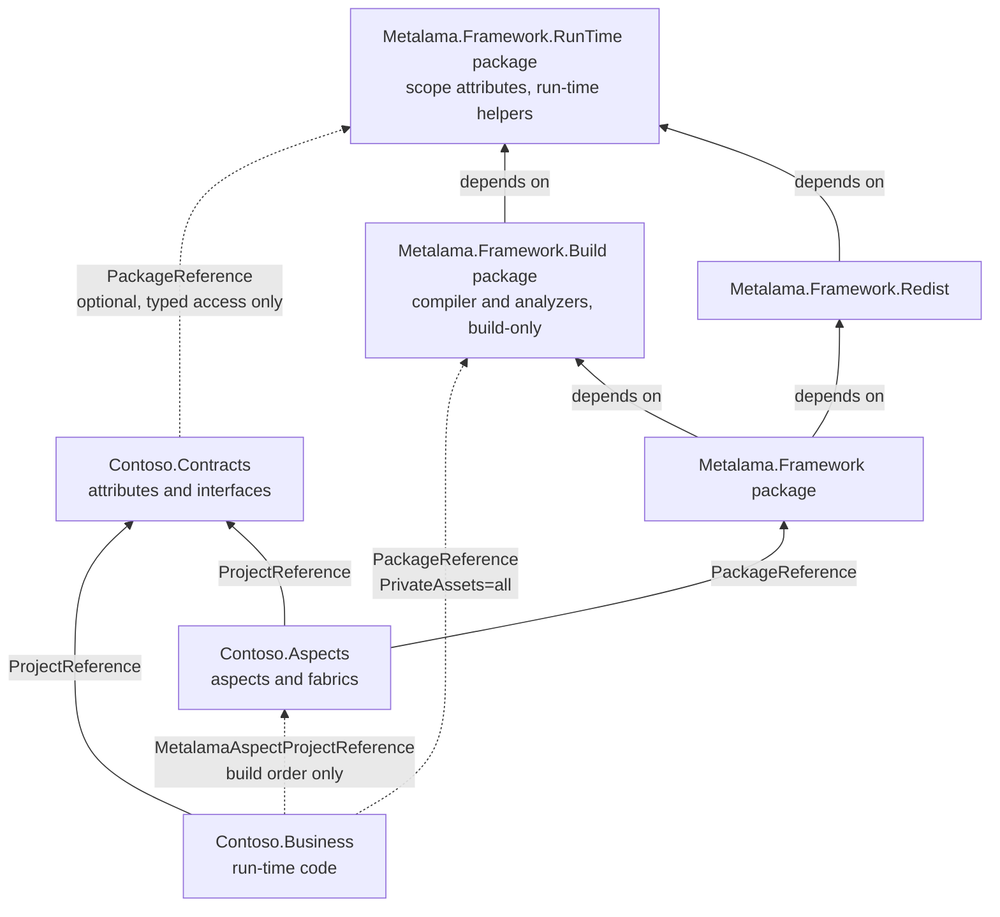

# Build-only aspect projects

This document explores a design in which the aspects of a solution live in a project that the business code
consumes as a build-only project reference, so that the business assemblies and packages depend on no Metalama
package other than a restored, minimal `Metalama.Framework.RunTime`. It is a design proposal. Nothing described
here is implemented. The file and line references describe `develop/2027.0` in October 2026.

## 1. The problem

A project that applies aspects today references the `Metalama.Framework` package, and that reference has two
consequences for the shipped product.

The first consequence is a run-time dependency on the whole framework assembly. The `Metalama.Framework` package
has no `lib` assets of its own (`Metalama.Framework.Package/Metalama.Framework.Package.csproj`,
`IncludeBuildOutput=false`), but it depends on `Metalama.Framework.Redist` with every asset included, and
`Metalama.Framework.Redist` is `Metalama.Framework.dll` itself (`Metalama.Framework/Metalama.Framework.csproj:5`).
That assembly carries the whole aspect, template, code model and fabric application programming interface. It is
copied to the output directory and becomes a dependency of any package produced from the project. The documented
mitigation, `PrivateAssets="all"` on `Metalama.Framework` plus a direct reference to `Metalama.Framework.Redist`
(`Metalama.Documentation/content/conceptual/aspects/distributing.md`), removes the build assets from consumers but
keeps the run-time dependency.

The second consequence is that the dependency cannot be removed by stripping the output assembly. The
`RunTimeAssemblyRewriter` (`Metalama.Framework.Engine/CompileTime/RunTimeAssemblyRewriter.cs:331-335`) replaces the
bodies of compile-time-only members with a `throw` statement but removes no type. Aspect classes stay in the
assembly, derive from `Metalama.Framework` base types, carry `[CompileTime]` or `[RunTimeOrCompileTime]`, and
receive `[CompiledTemplate]` on their non-public templates (`RunTimeAssemblyRewriter.cs:418-510`). These types are
part of the public surface of the assembly, because business code applies them as custom attributes, so removing
them would change the public application programming interface. The comment at `RunTimeAssemblyRewriter.cs:83-85`
records this limit: private compile-time code could be stripped, accessible compile-time metadata must remain.

The root cause is that one project holds both the run-time code and the aspects that transform it. As long as the
aspect classes are custom attributes applied in the same assembly, the assembly has to contain them.

GitHub issue metalama/Metalama#132 is the user-facing form of this problem: a developer wants a development-only
dependency on Metalama. The answer at the time was a conditional `PackageReference`, which is not a design.

## 2. History: the `Metalama.Framework.RunTime` package

The run-time helpers of the framework were a separate package once. Commit `ba305d2d4b` (October 2023, 2023.4)
moved `Metalama.Framework/RunTime` (`RunTimeAspectHelper`, `FieldOrPropertyInfo`, `ReflectionHelper`,
`AsyncEnumerableList`) to a repository of its own, published as `Metalama.Framework.RunTime`, and made both
`Metalama.Framework` and `Metalama.Framework.CompileTime` reference the package. The reference assembly locator
added the package to its generated project so that the compile-time compilation could resolve it. The README of
the folder at the time read: "This namespace contains types that can be used at run time only. Other namespaces
are compile-time only. We should probably split these in two projects."

Commit `90dcdff778` (January 2025, 2025.1, issue 35674) merged the package back into `Metalama.Framework.dll`,
removed the dependency from `Directory.Packages.props`, `eng/src/Program.cs`, the reference assembly locator and
the package README. Since then the `Metalama.Framework.RunTime` namespace has grown: `AspectGeneratedAttribute`,
`CallSiteHelper`, `AsyncEnumerableArray`, the `Events` types and the `Initialization` types were added inside
`Metalama.Framework.dll` (`Metalama.Framework/RunTime`).

This proposal restores the package, as a project of this repository rather than a separate repository, and gives
it one more responsibility: it defines the scope attributes. Section 6.3 details the content.

## 3. Goal and non-goals

The goal is a project topology in which:

- the business project references, at run time, no Metalama assembly other than `Metalama.Framework.RunTime.dll`,
  which is small, has no dependency, contains no compile-time surface, and does not replace the compiler;
- the package produced from the business project depends on `Metalama.Framework.RunTime` only, and only when the
  business code or the woven code uses one of its types;
- the aspects are compiled in a separate project that the business project references as a build-only project
  reference, so that MSBuild builds the aspect project first and never passes its output to the compiler of the
  business project or copies it to the output directory;
- the contract between the two, namely the custom attributes and interfaces that the business code uses and the
  aspects react to, lives in a third project that references nothing from Metalama, or only
  `Metalama.Framework.RunTime` when it opts into typed compile-time access to its types;
- the contracts project may target any framework and carry any dependency, because it may be a whole application
  framework rather than a thin set of attributes, and the aspect project targets whatever the contracts project
  requires;
- a fabric in the aspect project selects the declarations that carry the contract attributes and adds aspects to
  them, passing the attribute to the aspect;
- the configuration of the business project is two lines: a package reference and a project reference.

The following are not goals:

- Removing `Metalama.Framework.dll` from projects that keep the current topology. The current topology stays
  supported and unchanged.
- Flowing aspects from the business project to the projects that reference it. The consumers of the business
  project are not built with Metalama. Inheritable aspects and transitive fabrics stop at the business project.
- Removing the dependency on `Metalama.Framework.RunTime` as well. A design with no run-time package at all was
  explored first and is recorded in section 10. It requires a polyfill of the scope attributes in every contracts
  project and a per-feature list of what woven code may not use. The restored package removes both costs at the
  price of one small dependency.

## 4. Proposed topology



The solid edges are ordinary compile references. The dotted edges add nothing to the compilation of the business
project and nothing to its output directory. The aspect project must be built before the business project and
must not reference it, because the aspect project is an input of the build of the business project.

### 4.1. The contracts project

The contracts project is any class library. It declares the custom attributes that business code applies, for
example `[Log]` or `[Cached]`, and the interfaces or options types that both sides use. It may be a thin set of
attributes, or it may be a thick application framework targeting `net10.0` only, with heavy dependencies, in
which the attributes are a small part. The contracts project is not built with Metalama: it has no
`Metalama.Framework.Build` reference, so the compiler is the standard one and no analyzer runs.

```csharp
namespace Contoso.Contracts;

[AttributeUsage( AttributeTargets.Method )]
public sealed class LogAttribute : Attribute
{
    public LogAttribute( string? category = null ) => this.Category = category;

    public string? Category { get; }
}
```

The aspect project reads the attributes of the contracts assembly in one of two ways, and the choice is per
type:

- Through the code model, as `IAttribute`. The attribute type is an ordinary run-time type. The fabric selects
  declarations by `typeof(LogAttribute)` and reads the arguments through `IAttributeData` and
  `TryGetArgumentValue<T>` (`Metalama.Framework/Code/AttributeExtensions.cs:38-116`). Nothing of the contracts
  assembly is loaded into the compile-time domain, so the contracts assembly may have any target framework and
  any dependency. This is the default path and it works with a contracts project that references nothing from
  Metalama.
- As a constructed instance, through `Construct<LogAttribute>()`. The attribute type is marked
  `[RunTimeOrCompileTime]` from `Metalama.Framework.RunTime`, and the contracts assembly is loaded into the
  compile-time domain. The domain runs inside the compiler host, which is a .NET Framework 4.7.2 process in
  Visual Studio and in desktop MSBuild (`platform-support.md`, `Desktop=net472`), so this path requires the
  contracts assembly to be loadable there: `netstandard2.0`, with dependencies that the domain can load. This is
  the same constraint as for `MetalamaCompileTimeAssembly` today (`compile-time-target-frameworks.md`), and it is
  an opt-in for thin contracts projects that want typed access.

The second path is a convenience, not a requirement. A thick contracts assembly uses the first path and loses
nothing except the typed `LogAttribute` instance inside the fabric.

### 4.2. The aspect project

The aspect project is an ordinary Metalama project. It references `Metalama.Framework`, references the contracts
project, and is compiled by Metalama, so its output embeds the `Metalama.CompileTimeProject.zip` resource with the
compile-time sources and the manifest (`Metalama.Framework.Engine/CompileTime/CompileTimeConstants.cs:23`). The
run-time shape of its output assembly is irrelevant: no project ever compiles against it and no process ever
loads it as a run-time assembly. Only the embedded resource is consumed.

The aspect project targets whatever the contracts project requires, for example `net10.0` when the contracts
project is a `net10.0` application framework. Its target framework does not constrain the compile-time code,
because the compile-time compilation always targets `netstandard2.0` and is extracted from the sources
(`compile-time-target-frameworks.md`); it only constrains which target frameworks of the business project can
consume it, through the usual nearest-framework negotiation of project references.

The entry point is a `TransitiveProjectFabric`, because a `ProjectFabric` amends the project that declares it
(`Metalama.Framework/Fabrics/ProjectFabric.cs:44-53`), and the aspect project contains no business code. A
transitive fabric runs in every project that consumes the aspect project
(`Metalama.Framework.Engine/Fabrics/FabricManager.cs:53-62`), which in this topology is the business project.

```csharp
using Contoso.Contracts;
using Metalama.Framework.Code;
using Metalama.Framework.Fabrics;

namespace Contoso.Aspects;

public sealed class Fabric : TransitiveProjectFabric
{
    public override void AmendProject( IProjectAmender amender )
    {
        // Code model path: works with any contracts assembly.
        amender
            .SelectDeclarationsWithAttribute( typeof(LogAttribute) )
            .AddAspect( ( method, attribute ) => new LogAspect( attribute.GetArgumentValue<string>( "category" ) ) );
    }
}
```

`typeof(LogAttribute)` is legal in compile-time code even though `LogAttribute` is a run-time type: the compile-
time code rewriter replaces it with a `TypeOfResolver.Resolve` call that produces a `CompileTimeType` mock from
the metadata name (`Metalama.Framework.Engine/CompileTime/TypeOfRewriter.cs:30-69`), so the type is never
loaded. Member access on the type, such as `attribute.Category`, is not legal in compile-time code, which is why
the argument is read by name. With a thin contracts project that opted into `[RunTimeOrCompileTime]`, the same
fabric can use the typed overload instead:

```csharp
amender
    .SelectDeclarationsWithAttribute<LogAttribute>()
    .AddAspect( ( method, attribute ) => new LogAspect( attribute.Category ) );
```

The aspect classes themselves are unchanged. They derive from the usual base classes. No business code can apply
them as attributes, because the business project does not see the assembly. Section 7 describes the query
extensions used above.

### 4.3. The business project

```xml
<Project Sdk="Microsoft.NET.Sdk">

  <ItemGroup>
    <PackageReference Include="Metalama.Framework.Build" Version="2027.0.x" />
    <ProjectReference Include="../Contoso.Contracts/Contoso.Contracts.csproj" />
    <MetalamaAspectProjectReference Include="../Contoso.Aspects/Contoso.Aspects.csproj" />
  </ItemGroup>

</Project>
```

`Metalama.Framework.Build` is a new package described in section 6.2. It is a development dependency: the
`developmentDependency` flag of its manifest makes `PrivateAssets="all"` the default when the reference is added
with the .NET command line interface or with Visual Studio, and the package has no run-time asset.

`Metalama.Framework.RunTime` reaches the business project through `Metalama.Framework.Build`, so woven code can
use any run-time helper without configuration. The output assembly references the run-time assembly only when
the woven code uses one of its types. A business project that is packed and whose assembly references the
run-time assembly must also provide the dependency through a non-private reference, either directly or through
the contracts project; section 6.2 explains why and describes the pack-time check that enforces it. A package
produced from the business project therefore depends on `Metalama.Framework.RunTime` at most, and on nothing
else from Metalama. A business project whose contracts are thick and whose aspects emit no helper call depends
on nothing from Metalama at all.

`MetalamaAspectProjectReference` is a new item described in section 6.1.

The business code applies the contract attributes and nothing else:

```csharp
using Contoso.Contracts;

public class OrderService
{
    [Log( "Orders" )]
    public void PlaceOrder( Order order ) { /* ... */ }
}
```

## 5. What exists today and what is missing

| Need | Status today | Reference |
|---|---|---|
| A run-time package with the scope attributes and the helpers | Existed from 2023.4 to 2025.0 without the attributes; merged back since 2025.1. | Commits `ba305d2d4b` and `90dcdff778`; `Metalama.Framework/RunTime` |
| Build a project before another one without compiling against its output | Exists in MSBuild: `ProjectReference` with `ReferenceOutputAssembly="false"` and `OutputItemType`. Used in this repository for analyzers. | `Microsoft.Common.CurrentVersion.targets`, target `ResolveProjectReferences`; `Metalama.Framework.CompileTime/Metalama.Framework.CompileTime.csproj:39` |
| Pass a list of assembly paths from MSBuild to the engine | Exists: `MetalamaCompileTimeAssembly` and `MetalamaExtensionAssembly` items are converted into compiler-visible properties and parsed by `MSBuildProjectOptions`. | `Metalama.Framework.Package/build/Metalama.Framework.targets:70-74`; `Metalama.Framework.Engine/Options/MSBuildProjectOptions.cs:269-284` |
| Discover aspects and fabrics in an assembly that is not a compile reference | Missing. The repository builder walks `compilation.References` only. Extension assemblies load `PipelineExtension` and service factories only. | `Metalama.Framework.Engine/CompileTime/CompileTimeProjectRepository.Builder.cs:195-230`; `Metalama.Framework.Engine/Extensibility/ExtensionLoaderBase.cs:56-141` |
| Run the pipeline in a project with no reference to `Metalama.Framework.dll` | Missing. Three checks require the reference. | `Metalama.Framework.Engine/Pipeline/MetalamaProjectClassifier.cs:16-39`; `Metalama.Framework.Engine/CompileTime/CompileTimeCompilationBuilder.cs:869-879`; `Metalama.Framework.Engine/Pipeline/AspectPipeline.cs:137-180` |
| Resolve aspect and fabric types without a symbol in the business compilation | Partly exists. A referenced compile-time project can supply its own discovery compilation. Fabric drivers still resolve the fabric type in the run-time compilation. | `Metalama.Framework.Engine/Aspects/TemplateClassFactory.cs:60-83`; `Metalama.Framework.Engine/Fabrics/FabricDriver.cs:51-84` |
| Select declarations by a run-time-only attribute type and read its arguments without loading the type | Exists: `typeof(X)` in compile-time code becomes a `CompileTimeType` mock; `SelectDeclarationsWithAttribute(Type)`; `TryGetArgumentValue<T>`. | `Metalama.Framework.Engine/CompileTime/TypeOfRewriter.cs:30-69`; `QueryExtensions.cs:64-69`; `AttributeExtensions.cs:38-116` |
| Use a `[RunTimeOrCompileTime]` type from a non-Metalama assembly in compile-time code | Partly exists through `MetalamaCompileTimeAssembly`, with hard-coded paths and a repetition in every consuming project. Classification by attribute already works for referenced types. | `Metalama.Documentation/content/conceptual/aspects/templates/template-compile-time.md:167`; `SymbolClassifier.cs:727` |
| Construct an attribute instance from an `IAttribute` | Exists: `IAttribute.Construct<T>()` and `TryConstruct`, which require the attribute type in a compile-time project. | `Metalama.Framework/Code/AttributeExtensions.cs:126-162`; `Metalama.Framework.Engine/CompileTime/AttributeDeserializer.cs:63-91` |
| Select declarations by attribute in a fabric | Exists: `SelectDeclarationsWithAttribute<TAttribute>(predicate)`. The attribute instance is not passed to `AddAspect`. | `Metalama.Framework/Fabrics/QueryExtensions.cs:49-69`; `Metalama.Framework/Aspects/AspectQueryExtensions.cs:80-240` |
| A package with the build assets of Metalama and no run-time asset | Missing. `Metalama.Framework` bundles the analyzers, the build files and the dependency on `Metalama.Framework.Redist`. | `Metalama.Framework.Package/Metalama.Framework.Package.csproj:58-72` |

## 6. Mechanism

### 6.1. MSBuild: the `MetalamaAspectProjectReference` item

The item is declared by the user and rewritten by the Metalama build files into a `ProjectReference` that MSBuild
already understands:

```xml
<!-- Metalama.Framework.Build.targets -->
<ItemGroup>
  <ProjectReference Include="@(MetalamaAspectProjectReference)"
                    ReferenceOutputAssembly="false"
                    OutputItemType="MetalamaAspectAssembly"
                    Private="false" />
</ItemGroup>

<Target Name="ExportMetalamaAspectAssemblies"
        DependsOnTargets="ResolveProjectReferences"
        BeforeTargets="GenerateMSBuildEditorConfigFileCore">
  <PropertyGroup>
    <MetalamaAspectAssemblies>@(MetalamaAspectAssembly->'%(FullPath)', ',')</MetalamaAspectAssemblies>
    <MetalamaAspectProjectFiles>@(MetalamaAspectAssembly->'%(MSBuildSourceProjectFile)', ',')</MetalamaAspectProjectFiles>
  </PropertyGroup>
</Target>
```

`MetalamaAspectAssemblies` is declared as a `CompilerVisibleProperty`, like `MetalamaCompileTimeAssemblies`, and
read by a new `MSBuildProjectOptions.AspectAssemblies` member. The path validation at
`Metalama.Framework.targets:253-266` applies, because `,` and `|` are the separators of the property.

The semantics of `ReferenceOutputAssembly="false"` with `OutputItemType` are verified in the common targets of the
.NET 10 SDK (`Microsoft.Common.CurrentVersion.targets`, target `ResolveProjectReferences`):

- On the command line, the `MSBuild` task builds the referenced project and writes its target outputs into the
  item named by `OutputItemType`; `_ResolvedProjectReferencePaths` receives nothing, so the compiler gets no
  reference and nothing is copied to the output directory.
- Inside Visual Studio, the same target calls `GetTargetPath` on the referenced project, which Visual Studio has
  already built in dependency order, and writes the result into the same item. Visual Studio honours
  `ReferenceOutputAssembly="false"` project references for build ordering.
- The output items carry the `MSBuildSourceProjectFile` metadata, which section 6.7 uses.

The target framework of the aspect project is negotiated as for any project reference: MSBuild selects the
nearest compatible target framework of the aspect project for each target framework of the business project, and
fails when there is none. The aspect project therefore targets what its contracts require, `net10.0` for a
`net10.0` application framework, or `netstandard2.0` when it has no such constraint. The item transform copies
the metadata of the user item, so a user can set `SetTargetFramework` on `MetalamaAspectProjectReference` when
the default selection is not the intended one. When the aspect project multi-targets and several of its target
frameworks are consumed by a multi-targeted business project, the business project gets one compile-time project
per pair, which `compile-time-target-frameworks.md` already describes for ordinary references.

`MetalamaAspectProjectReference` is preferred over a documented pattern on `ProjectReference` with custom metadata
for two reasons. The item name states the intent, and the rewrite happens in one place that the design-time and
build-time paths share. A `ProjectReference` with `MetalamaAspects="true"` metadata is a possible alias and is
not needed for the first version.

### 6.2. Packaging

The `Metalama.Framework` package today ships three things (`Metalama.Framework.Package.csproj:33-82`): the
analyzers in `analyzers/dotnet/cs` (the compiler extension with the embedded engine, the editor extensions and the
`[Durable]` analyzer), the `build` and `buildTransitive` files, and the dependencies on `Metalama.Framework.Redist`
with every asset and on `Metalama.Compiler` with `Build` and `Analyzers` excluded. `Metalama.Framework.Redist` is
the whole `Metalama.Framework.dll`.

The proposal is the following package set:

| Package | Content | Dependencies | Flags |
|---|---|---|---|
| `Metalama.Framework.RunTime` (restored) | `Metalama.Framework.RunTime.dll`: the scope attributes and the run-time helpers (section 6.3) | none | none |
| `Metalama.Framework.Build` (new) | Analyzers, `build`, `buildTransitive` | `Metalama.Compiler` (as today), `Metalama.Framework.RunTime` with every asset | `developmentDependency=true` |
| `Metalama.Framework.Redist` | `Metalama.Framework.dll`, with type forwarders to the run-time assembly | `Metalama.Framework.RunTime` | as today |
| `Metalama.Framework` (unchanged for users) | Empty `lib` placeholders | `Metalama.Framework.Build` with every asset, `Metalama.Framework.Redist` with every asset, `Microsoft.CSharp` | as today |

The existing topology does not change: a project that references `Metalama.Framework` gets the analyzers and
build files through `Metalama.Framework.Build`, and the run-time assemblies through `Metalama.Framework.Redist`
and its dependency. The `PackageReference Update="Metalama.Framework" PrivateAssets="none"` at
`build/Metalama.Framework.props:4` keeps flowing the build assets to the consumers of aspect libraries. The
`buildTransitive` files of `Metalama.Compiler` keep flowing through the `Build` package, because
`ExcludeAssets="Build"` excludes the `build` folder and not the `buildTransitive` folder, which is what the current
nuspec relies on.

The run-time package is a project of this repository, `Metalama.Framework.RunTime`, targeting `netstandard2.0`
and `net10.0` like `Metalama.Framework`, referenced by `Metalama.Framework` and by `Metalama.Framework.CompileTime`
as a project reference. The 2023 split used a separate repository with its own versioning, which the 2025 merge
undid. A project in this repository shares the version of the product, which is simpler, and the package is small
enough that the version churn costs nothing. The reference assembly locator needs no change for the package,
because it obtains `Metalama.Framework.dll` and its dependencies through the `Metalama.Framework` package of its
generated project (`Metalama.Framework.Engine/CompileTime/CompileTimeAssemblyLocator.cs`).

The `Metalama.Framework.Build` package is what makes a project a Metalama project. A business project references
it directly and privately. Its consumers see no Metalama package other than the run-time package, which is the
desired outcome and is also a constraint: a transitive fabric or an inheritable aspect that the business project
would expose cannot be honoured by its consumers. The build files should report a warning when a project with no
`Metalama.Framework` reference embeds an inheritable aspect manifest (section 6.8).

The `Build` package depends on the run-time package so that every Metalama project compiles against
`Metalama.Framework.RunTime.dll` and copies it to its output directory without configuration. Woven code can then
use any run-time helper, and an application needs nothing beyond the two lines of section 4.3. The compiler drops
the reference from the output assembly when nothing uses it, so a business assembly references the run-time
assembly only when its woven code needs it.

This dependency has one consequence for projects that are packed. NuGet pack writes into the nuspec the direct
package references of the project that are not private, and nothing else; a dependency reached only through a
private reference is omitted. The reference to `Build` is private, so `RunTime` does not appear in the nuspec of
a business package unless the project references it directly as well, or reaches it through a project reference
to a contracts project that does. A business package whose assembly references the run-time assembly and whose
nuspec does not declare it would fail on the consumer's machine, with no diagnostic at build time. The `Build`
targets therefore add a check before `GenerateNuspec`: when the output assembly references
`Metalama.Framework.RunTime` and no `PackageReference` or `ProjectReference` of the project provides it without
`PrivateAssets="all"`, pack fails with an error that names the missing reference. The check reads the assembly
references of the built output, which `GetReferencedAssemblies` on a metadata reader gives for the cost of
opening the file. Adding the reference from the `Build` props instead is not an option: NuGet imports the props
of a package after restore, so a `PackageReference` declared there is not part of the restore graph.

The alternative of keeping one package and referencing it with `ExcludeAssets="runtime;compile"` is rejected. The
asset flags of a direct reference apply to the direct package, and whether and how they apply to its dependencies
is a NuGet detail that users would have to get right in every project. A package whose name says what it is for
needs no such knowledge.

The name of the new build package is open. `Metalama.Framework.Build` matches the content.
`Metalama.Framework.BuildTools` and `Metalama.Framework.Compiler` were considered; the latter collides with the
`Metalama.Compiler` fork in the mind of a reader. The name of the run-time package is the historical one,
`Metalama.Framework.RunTime`; the shorter `Metalama.RunTime` is possible and would be a new identifier on
nuget.org.

### 6.3. The content of `Metalama.Framework.RunTime`

The package contains two groups of types, both moved from `Metalama.Framework.dll` with their namespaces
unchanged and with `[TypeForwardedTo]` left behind in `Metalama.Framework.dll`, so that assemblies compiled
against an earlier `Metalama.Framework.Redist` keep loading against the new one.

The scope attributes, in `Metalama.Framework.Aspects`: `CompileTimeAttribute`, `RunTimeAttribute`,
`RunTimeOrCompileTimeAttribute`, `CompileTimeReturningRunTimeAttribute` and
`ForcedGenericRunTimeOrCompileTimeAttribute`, which are the attributes that `SymbolClassifier.GetTemplatingScope`
recognizes (`SymbolClassifier.cs:255-267`) and that a contracts project needs. `TemplateAttribute`,
`IntroduceAttribute` and `InterfaceMemberAttribute` are recognized by the same method but belong to aspect
classes, which always reference `Metalama.Framework`, so they stay where they are.

The run-time helpers, in `Metalama.Framework.RunTime`, which is the whole `Metalama.Framework/RunTime` folder:
`AspectGeneratedAttribute`, `AsyncEnumerableArray`, `AsyncEnumerableList`, `CallSiteHelper`,
`FieldOrPropertyInfo`, `ReflectionHelper`, `RunTimeAspectHelper`, the `Events` types (`EventBroker`,
`DelegateList`, `DelegateEventAdapter`, `IEventAdapter`, `EventBrokerServices`, `EventHandlerInvocationCallback`)
and the `Initialization` types (`IInitializable`, `InitializationContext`, `InitializationMetadata`,
`InitializationSlot`, `InitializationSlotFactory`, `InitializableExtensions`, `CallerIntent`).

Two rules keep the package minimal:

- A type goes into the package only when woven code references it, or when business or contract code must apply
  it. The engine emits references to every type in the second group (`AdviceImpl/Introduction/Constructors/IntroduceConstructorParameterAdvice.cs:229`,
  `AdviceImpl/Initialization/OnConstructedEpilogueEmitter.cs:217`, `Advising/TemplateBindingHelper.cs`,
  `Extensibility/CallSites/ExtensionTransformationFactory.ArgumentPlan.cs:328`, `Linking/InitializableTypeRegistry.cs`,
  `Linking/Substitution/EventRaiseBrokerCallSubstitution.cs`).
- The package depends on nothing, so that it never constrains the dependency graph of a business package. The
  `netstandard2.0` flavor of `Metalama.Framework.Redist` today depends on `Microsoft.Bcl.AsyncInterfaces`,
  `Microsoft.Bcl.HashCode`, `Microsoft.CSharp` and `System.Collections.Immutable`; the `AsyncEnumerable*` helpers
  need `IAsyncEnumerable<T>`, so the `netstandard2.0` flavor of the run-time package needs
  `Microsoft.Bcl.AsyncInterfaces` and nothing else. The `net10.0` flavor needs nothing.

`IFieldOrProperty.ToFieldOrPropertyInfo()` returns `FieldOrPropertyInfo`, so `Metalama.Framework.dll` references
the run-time assembly, which is the same direction as in 2023.

### 6.4. Engine: compile-time projects from aspect assemblies

The repository builder (`CompileTimeProjectRepository.Builder.cs:195-230`) starts from the framework project and
loops over `runTimeCompilation.References`. The proposal adds a second loop over
`ProjectOptions.AspectAssemblies`, which calls the existing `TryGetCompileTimeProjectFromPath`
(`CompileTimeProjectRepository.Builder.cs:355-486`) for each path. That method already handles an assembly with
an embedded `Metalama.CompileTimeProject.zip`: it reads the manifest, recompiles the sources into an
`ml!<name>_<hash>` assembly, and resolves the manifest references. The resulting projects are added to the
references of the compile-time project of the business project, so that:

- `FabricManager.ExecuteFabrics` (`FabricManager.cs:53-62`) finds the transitive fabrics of the aspect project;
- `TemplateClassFactory` (`TemplateClassFactory.cs:39-123`) finds the aspect classes in the closure;
- hierarchical options types are found as today.

The compile-time project of the business project is empty, because the project has no compile-time code, which
`CompileTimeCompilationBuilder` already supports when referenced projects exist
(`CompileTimeCompilationBuilder.cs:1180-1198`).

Three checks that require a reference to `Metalama.Framework.dll` change their condition to "the project
references `Metalama.Framework.dll` or declares at least one aspect assembly". A reference to the run-time
package alone does not enable the pipeline: the contracts project references it and is an ordinary project.

- `MetalamaProjectClassifier.TryGetMetalamaVersion` (`MetalamaProjectClassifier.cs:16-39`) requires the
  `METALAMA` preprocessor symbol and a referenced assembly named `Metalama.Framework`. The build files define
  `METALAMA` in every Metalama-enabled project, so the symbol check stays. The assembly check is replaced, and the
  version that the classifier returns comes from `CompileTimeProjectManifest.MetalamaVersion` of the aspect
  assemblies when there is no reference.
- `CompileTimeCompilationBuilder.TryGetCompileTimeProject` (`CompileTimeCompilationBuilder.cs:869-879`) returns
  no project when no reference has the file name `Metalama.Framework`. The condition gains the aspect assemblies.
- `AspectPipeline.TryInitialize` (`AspectPipeline.cs:165-180`) compares the referenced `Metalama.Framework`
  version with the engine version. With no reference, the comparison uses the manifest version of each aspect
  assembly, which the existing `DependencyMustBeRecompiled` diagnostic already covers when the manifest version
  differs (`CompileTimeProjectRepository.Builder.cs:616-734`).

The compile-time compilation of the business project does not need the business project to reference
`Metalama.Framework.dll`. It references `CompileTimeAssemblyLocator.MetadataReferences`
(`CompileTimeCompilationBuilder.cs:473-481`), which is the fixed set that the locator obtains from its own
generated project, and that set contains `Metalama.Framework.dll` at the engine version.

Two resolutions of types as symbols of the business compilation need a different source, because the aspect
assembly is not a reference of that compilation:

- Aspect classes. `TemplateClassFactory` resolves each aspect type name with `GetTypeByMetadataName` in
  `item.Project.TemplateReflectionContext ?? this.CompilationContext` (`TemplateClassFactory.cs:60-66`), and
  `CompileTimeProject.TemplateReflectionContext` (`CompileTimeProject.cs:75`) comes from a
  `CacheableTemplateDiscoveryContextProvider`, which builds a discovery compilation from the portable executable
  references of the compilation with `MetadataImportOptions.All`
  (`CacheableTemplateDiscoveryContextProvider.cs:43-47`). For an aspect assembly, the provider is created with
  the references of the business compilation plus the aspect assembly itself and its reference closure. The
  aspect types then resolve in that discovery compilation without being visible to the business code.
- Fabrics. `FabricDriver.GetCreationData` (`FabricDriver.cs:51-84`) resolves the fabric type in the run-time
  compilation through the `ReflectionMapper`, and `ProjectFabricDriver` (`ProjectFabricDriver.cs:49-50,102`) uses
  the containing assembly of the fabric to compute the depth in the reference graph and to obtain the `IAssembly`
  of the code model. Both need a branch for a fabric whose assembly is not referenced: the symbol comes from the
  same discovery compilation as above, and the depth is one more than the depth of the business project, which is
  the depth a direct reference would have. The code model `IAssembly` that `IFabricInstance` exposes for such a
  fabric is a declaration of the discovery compilation and is not reachable from the business compilation
  through `ICompilation.ReferencedAssemblies`. Whether that matters to any public contract of `IFabricInstance`
  is an open question (section 9).

Aspect instances are created through the fabric and the aspect class only. `CompilationAspectSource`
(`Metalama.Framework.Engine/Aspects/CompilationAspectSource.cs:73-133`), which turns custom attributes whose
class is an aspect class into aspect instances, finds nothing in this topology and needs no change.

### 6.5. Engine: contract types at compile time

The aspect project uses contract types in compile-time code, in one of the two ways of section 4.1.

#### The code model path

The fabric names the attribute type through `typeof(LogAttribute)`, which the compile-time code rewriter turns
into a `TypeOfResolver.Resolve` call (`ProduceCompileTimeCodeRewriter`, `TypeOfRewriter.cs:30-69`), and
`ReflectionMapper.GetTypeSymbol` accepts the resulting `CompileTimeType` mock
(`Metalama.Framework.Engine/CodeModel/Helpers/ReflectionMapper.cs:87-98`). `SelectDeclarationsWithAttribute(Type)`
(`QueryExtensions.cs:64-69`) and `IAttributeCollection.OfAttributeType(Type)` resolve the mock against the
business compilation, where the contracts assembly is an ordinary reference. The arguments are read from
`IAttributeData.ConstructorArguments` and `NamedArguments`, or through `TryGetArgumentValue<T>`, which matches
constructor parameters and named arguments by name without constructing anything
(`AttributeExtensions.cs:38-116`).

This path needs no engine change. The contracts assembly stays a run-time-only reference of the business
compilation; the compile-time compilation never references it and the compile-time domain never loads it. The
restriction is that compile-time code cannot access members of the attribute type, because
`TemplatingCodeValidator` rejects the use of a run-time-only type in compile-time code, so the fabric reads
arguments by name. Section 9 records a possible future convenience for this.

#### The typed path

The fabric uses `LogAttribute` as a type: generic `SelectDeclarationsWithAttribute<LogAttribute>()`,
`Construct<LogAttribute>()`, or a typed constructor parameter of the aspect. Three things must then hold for the
contract type.

The type must be classified as run-time-or-compile-time in the aspect project. `SymbolClassifier` classifies a
referenced type from its own attributes (`SymbolClassifier.cs:727`, through `GetScopeFromAttributes`), which it
matches by simple name (`SymbolClassifier.cs:255-267`). With the real attribute from the run-time package, both
the name and the full name match, so this works as is. `GetAssemblyScope` (`SymbolClassifier.cs:269-295`)
deliberately ignores an assembly-level `[RunTimeOrCompileTime]`, because "we must take the decision for each
type", so the attribute goes on each contract type and not on the assembly.

The type must be referenced by the compile-time compilation of the aspect project, and later by the compile-time
compilation of the business project when it recompiles the embedded sources. The compile-time compilation
references the fixed set plus the referenced compile-time projects (`CompileTimeCompilationBuilder.cs:473-481`),
and the contracts assembly is in neither. Today the only way to add it is a `MetalamaCompileTimeAssembly` item
with a hard-coded output path, repeated in the business project. The proposal is a third kind of compile-time
project, next to the transformed and the untransformed kinds: an assembly with no embedded resource and no
`[assembly: CompileTime]`, but with at least one type marked `[RunTimeOrCompileTime]`, is loaded as a
"foreign compile-time assembly". It is referenced by the compile-time compilation as is, loaded into the
compile-time domain as is (`CompileTimeProject.TryCreateUntransformed`, `CompileTimeProject.cs:337-459`, already
does both for the untransformed kind), and contributes no aspect, fabric or option type. `MetadataReader`
(`MetadataReader.cs:93-119`) gains a flag for the presence of the attribute on any type, which costs one pass over
the type definitions of the metadata. The run-time assembly itself is excluded from this kind: it is part of the
fixed reference set of every compile-time compilation.

The assembly must be loadable in the compile-time domain of every host, which includes the .NET Framework 4.7.2
hosts of the platform baseline. A `netstandard2.0` assembly with loadable dependencies qualifies. A `net10.0`
assembly does not, and the engine must report a clear diagnostic when an assembly marked
`[RunTimeOrCompileTime]` cannot be loaded, naming the code model path as the alternative, instead of failing
with a `FileLoadException` or `BadImageFormatException` from `domain.LoadAssembly`.

The type must be constructible by `AttributeDeserializer` (`AttributeDeserializer.cs:63-91`), which resolves the
attribute class through `ProjectSpecificCompileTimeTypeResolver` (`ProjectSpecificCompileTimeTypeResolver.cs:33-58`)
and that resolver asks the repository for the compile-time project of the containing assembly. With the contracts
assembly registered as a foreign compile-time assembly, `GetTypeOrNull` returns the type from the loaded
assembly and construction succeeds. Without this registration, `Construct<T>` reports LAMA0401.

The `SymbolClassifier` constructor (`SymbolClassifier.cs:152-160`) detects the framework through
`RunTimeOrCompileTimeAttribute` by full name, then resolves `TemplateAttribute` and `DeclarativeAdviceAttribute`
with an assertion that they exist. Once the scope attributes live in the run-time assembly, a business or
contracts project satisfies the first lookup and fails the assertion, so the two template attributes must become
optional in that constructor. `CompileTimeCodeFastDetector` (`CompileTimeCodeFastDetector.cs:20-75`) considers a
syntax tree only when it imports a `Metalama.Framework` namespace; a contracts project imports
`Metalama.Framework.Aspects` for the attribute, but the detector only runs in projects built with Metalama, which
the contracts project is not.

### 6.6. Engine: what woven code references in the business assembly

The transformed business assembly may reference `Metalama.Framework.RunTime.dll`, which every Metalama project
references through the `Build` package (section 6.2), and must not reference `Metalama.Framework.dll`. With the
content of section 6.3, every type that the engine emits on its own is in the run-time assembly, and the helpers
that templates call explicitly (`ToFieldOrPropertyInfo()`, enumerable buffering through `meta.Proceed()`) are
too.

A safety net remains useful, because the inventory is maintained by hand and a template can reference any
run-time-or-compile-time type of `Metalama.Framework.dll` in a run-time expression. When the project has no
reference to `Metalama.Framework.dll`, the pipeline walks the symbols that the transformed syntax trees bind to,
after linking, and reports one diagnostic per distinct type of that assembly, with the location of the aspect
that introduced it. Without this pass, the compiler reports CS0012 ("the type is defined in an assembly that is
not referenced") against generated code, which the user cannot act on. The same pass is the test that keeps the
run-time package complete: a type that the pass reports in the test suite of this repository is a type that
belongs in the package.

### 6.7. Design time

Inside Visual Studio, Rider and the C# Dev Kit, the design-time pipeline reads `MetalamaAspectAssemblies` from the
analyzer configuration like any other property, and loads the aspect assemblies from disk. Two consequences
follow from the fact that the aspect project is not a reference of the business project in the Roslyn workspace.

The first consequence is staleness. The design-time pipeline for a referenced Metalama project today works on a
`CompilationReference` and reuses the pipeline of the upstream project
(`CompileTimeProjectRepository.Builder.cs:255-352`, issue #1611), so an edit to an aspect is visible in the
consuming project without a build. With a build-only reference, the business project sees the aspect assembly
as it was last built. Before the first build, the file does not exist, and the pipeline must report nothing
rather than fail, in the same way that `DesignTimeAspectPipelineFactory` returns null for a project where
Metalama is not enabled (`DesignTimeAspectPipelineFactory.cs:453-458`).

The second consequence is the mitigation. The output item of a project reference carries the
`MSBuildSourceProjectFile` metadata, so the build files export, next to each assembly path, the path of the
project that produced it (`MetalamaAspectProjectFiles` in section 6.1). The design-time pipeline factory can then
look for a workspace project with that file path and, when it finds one, use its compilation as the source of the
compile-time project, through the existing `TryGetCompileTimeProjectFromCompilation` branch. The disk file remains
the fallback. This gives the same live-edit behaviour as today, and it is the part of the design that needs a
prototype before the design is accepted, because the design-time pipeline keys its caches by project and by
reference set (`design-time-memory.md`) and an aspect project that is not a reference does not participate in
those keys.

The alternative of keeping a real `ProjectReference` during design-time builds only, so that Roslyn sees the
aspect project as a compilation reference, is rejected. The business project would then see the aspect types and
`Metalama.Framework.dll` in the editor and not in the build, and code that compiles in the editor would fail on
the command line.

### 6.8. Consumers of the business project

A project that references the business project is not built with Metalama. The output of the business project
should therefore contain nothing that a Metalama-built consumer would act on:

- The `Metalama.InheritableAspects.bin` resource (`CompileTimeAspectPipeline.cs:333-351`) is written when the
  project has inheritable aspect instances, inheritable options or annotations. In this topology the resource is
  inert and should be omitted, with a warning when it would have had content, because the user expects the
  inheritable aspect to flow and it will not.
- The `Metalama.CompileTimeProject.zip` resource is not written for a project without compile-time code.

### 6.9. Licensing

The license is consumed in the project where aspects are applied, which is the business project. The
`Metalama.Framework.Build` package carries the `Metalama.Compiler` dependency that exports `MetalamaLicense`
(`Metalama.Compiler.props:150`), so license resolution is unchanged. The aspect project also builds with a
license, as any Metalama project does today.

## 7. Fabric application programming interface

The scenario needs the attribute instance in the `AddAspect` delegate. Today the only way is a tagged query, as
the proxy sample does (`Metalama.Samples/src/Metalama.Samples.Proxy/FabricExtensions.cs`):

```csharp
amender
    .SelectDeclarationsWithAttribute( typeof(LogAttribute) )
    .WithTag( d => d.Attributes.OfAttributeType( typeof(LogAttribute) ).Single().Construct<LogAttribute>() )
    .AddAspect( ( d, attribute ) => new LogAspect( attribute.Category ) );
```

The proposal adds two overloads to `QueryExtensions` (`Metalama.Framework/Fabrics/QueryExtensions.cs`) that
return a tagged query, so that the existing tagged `AddAspect` and `AddAspectIfEligible` overloads of
`AspectQueryExtensions` (`AspectQueryExtensions.cs:190-240`) apply. The first serves the code model path and
tags each declaration with its `IAttribute`; the second serves the typed path and tags it with the constructed
instance:

```csharp
public static IQuery<IDeclaration, IAttribute> SelectDeclarationsWithAttribute(
    this IQuery<ICompilation> query,
    Type attributeType,
    bool includeDerivedTypes = true );

public static IQuery<IDeclaration, TAttribute> SelectDeclarationsWithAttribute<TAttribute>(
    this IQuery<ICompilation> query,
    bool includeDerivedTypes = true )
    where TAttribute : Attribute;
```

The first overload conflicts with the existing `SelectDeclarationsWithAttribute(Type, Func<IAttribute, bool>?, bool)`
only in the return type, so it needs a distinct name or the existing overload has to change its return type to
the tagged query, which is source-compatible for every caller that discards the tag. The latter is the simpler
option and is proposed.

On top of them, one convenience per path, which also reports an error at the attribute when the target is not
eligible, instead of skipping it silently as `AddAspectIfEligible` does:

```csharp
public static void AddAspectForAttribute<TAspect>(
    this IQuery<ICompilation> query,
    Type attributeType,
    Func<IDeclaration, IAttribute, TAspect> createAspect )
    where TAspect : IAspect;

public static void AddAspectForAttribute<TAttribute, TAspect>(
    this IQuery<ICompilation> query,
    Func<IDeclaration, TAttribute, TAspect> createAspect )
    where TAttribute : Attribute
    where TAspect : IAspect;
```

The `IAttribute` is an `IAspectPredecessor` (`Metalama.Framework/Code/IAttribute.cs:36`), so the aspect instance
created by `AddAspectForAttribute` records the attribute, and not only the fabric, as its predecessor. Diagnostics
reported by the aspect then point at the attribute in the business code, which is where the user wrote the
intent.

`Construct<TAttribute>` requires the attribute type in a compile-time project (section 6.5). When the type is not
available, the typed `AddAspectForAttribute` reports LAMA0401 with the hint to mark the type
`[RunTimeOrCompileTime]` or to use the `Type`-based overload.

Nothing in this section is specific to build-only aspect projects. The overloads are useful in the current
topology whenever an aspect library reacts to attributes that it does not own.

## 8. Changes by component

| Component | Change |
|---|---|
| `Metalama.Framework.RunTime` project (restored) | Scope attributes and the `RunTime` folder, moved from `Metalama.Framework`; type forwarders left in `Metalama.Framework.dll`; project references from `Metalama.Framework` and `Metalama.Framework.CompileTime`; entry in `eng/src/Program.cs`. |
| Packaging | New `Metalama.Framework.Build` package, depending on `Metalama.Compiler` and `Metalama.Framework.RunTime`; `Metalama.Framework` depends on it; `Metalama.Framework.Redist` depends on `Metalama.Framework.RunTime`; the `Metalama.Framework.Package` project becomes a shell. |
| Build files | `MetalamaAspectProjectReference` item, its rewrite to `ProjectReference`, the `ExportMetalamaAspectAssemblies` target, the `MetalamaAspectAssemblies` and `MetalamaAspectProjectFiles` compiler-visible properties; the pack-time check for an undeclared `Metalama.Framework.RunTime` dependency. |
| `MSBuildProjectOptions` | `AspectAssemblies` and `AspectProjectFiles` members, parsed like `CompileTimeAssemblies`. |
| `CompileTimeProjectRepository.Builder` | Second discovery loop over aspect assemblies; foreign compile-time assembly kind; `MetadataReader` flag for `[RunTimeOrCompileTime]`. |
| `MetalamaProjectClassifier`, `CompileTimeCompilationBuilder`, `AspectPipeline` | Enablement and version checks accept aspect assemblies in place of the framework reference. |
| `CacheableTemplateDiscoveryContextProvider`, `TemplateClassFactory`, `FabricDriver`, `ProjectFabricDriver` | Discovery compilation that includes the aspect assembly; fabric resolution and depth for a non-referenced fabric. |
| `SymbolClassifier` | The template attributes become optional when only the run-time assembly is referenced. |
| Pipeline output | Diagnostic pass for `Metalama.Framework.dll` types in the transformed code; omission of the inheritable manifest with a warning. |
| Design time | Aspect assemblies in the pipeline options; project-file mapping to workspace projects; graceful absence of the file. |
| `Metalama.Framework` | `SelectDeclarationsWithAttribute` returning tagged queries for both the `Type` and the generic form; `AddAspectForAttribute` for both. |
| Tests | Two standalone tests with the three projects, built twice each (command line and a design-time build). The first has a thin `netstandard2.0` contracts project with `[RunTimeOrCompileTime]` and the typed path. The second has a thick `net10.0`-only contracts project with a heavy dependency, no Metalama reference, and the code model path; it asserts that the business assembly references neither `Metalama.Framework` nor `Metalama.Framework.RunTime` and that its output directory contains no Metalama assembly. The aspect test suite runs with the diagnostic pass enabled, so that any new emitted type of `Metalama.Framework.dll` is caught. |
| Documentation | A conceptual article for the topology; updates to `distributing.md` and `packages.md`; the restored package in the package list. |

## 9. Open questions

1. The code model identity of a fabric or an aspect class whose assembly is not referenced (section 6.4). The
   `IAssembly` that `IFabricInstance` and `IAspectClass` expose would belong to the discovery compilation. The
   public contract of these interfaces needs a review before the design is accepted.
2. The design-time mapping of aspect assemblies to workspace projects (section 6.7) needs a prototype, because
   the design-time caches are keyed by reference sets that the aspect project does not participate in.
3. The reference closure of the aspect project. When the aspect project uses a compile-time package
   (`MetalamaCompileTimePackage`) or a compile-time assembly, the business project must repeat the declaration
   today (`template-compile-time.md:167`). The build-only reference makes that repetition worse, because the
   business project has no reason to know about the dependencies of the aspect project. A sidecar file written
   by the build of the aspect project, listing its `ReferencePathWithRefAssemblies`, and read by the engine next
   to the aspect assembly, would remove the repetition. This is a separate improvement that applies to the current
   topology as well.
4. Whether `Metalama.Patterns.*` and `Metalama.Extensions.*` libraries can be used from the aspect project. They
   are referenced by the aspect project and their run-time parts (for example the caching back-ends) are then
   needed by the business project through an ordinary package reference. The compile-time parts come through the
   closure of the aspect assembly. Nothing in this document prevents it, and nothing in this document tests it.
   The run-time parts of those libraries reference `Metalama.Framework.dll` today and would need the same split
   to stay free of it.
5. The exact boundary of the run-time package (section 6.3). The two rules decide the first version; whether
   `ExcludeAspectAttribute`, the `Metalama.Framework.Options` types or `ICompileTimeSerializable` belong there
   depends on whether contract types need them, and is best decided on the first real contracts project.
6. The names of the two packages and of the new item.
7. Typed access to a thick contracts attribute without loading its assembly. The code model path reads arguments
   by name, which is correct but loses compile-time checking of the argument names. The engine could compile a
   compile-time projection of the attribute class from its metadata (the public constructors and the settable
   properties, with no body and no base type other than `Attribute`) into the compile-time compilation, so that
   `Construct<LogAttribute>()` returns an instance of the projection and `attribute.Category` compiles. The
   projection would be a new kind of compile-time type, distinct from the real type, and its identity rules need
   a design of their own. It is not part of this proposal.

## 10. Alternatives considered

- No run-time package at all, with a polyfill of `[RunTimeOrCompileTime]` declared `internal` in each contracts
  project. The engine already binds the scope attributes by simple name, so the polyfill classifies correctly.
  The alternative was the first draft of this document. It was dropped because every feature whose woven code
  references a framework helper (`ToFieldOrPropertyInfo()`, enumerable buffering, introduced constructor
  parameters, initialization advice, event brokers, call-site interceptors) would have to be either forbidden in
  the business project or re-emitted as `internal` copies, and because every contracts project would carry a
  hand-written attribute that the documentation has to explain.
- Stripping the aspect classes from the output of a mixed project. Rejected for the reason given in section 1:
  the classes are the public attributes that the business code applies, and the rewriter cannot remove them
  without changing the public surface.
- Marking the aspect project `MetalamaCompileTimeProject=True` so that it is consumed untransformed. Rejected: an
  untransformed assembly is loaded as is (`CompileTimeProject.TryCreateUntransformed`) and its templates have not
  been transformed into template-generating code, so templates would not work. The property is meant for
  weaver-based and service assemblies.
- Loading the aspect assembly as a `MetalamaExtensionAssembly`. Rejected: extension assemblies are scanned for
  `[assembly: ExportExtension]` only (`ExtensionLoaderBase.cs:56-141`) and cannot contribute aspect classes,
  which come from the compile-time project closure only (`TemplateClassFactory.cs:57-59`).
- A real `ProjectReference` in design-time builds only. Rejected in section 6.7.
- Asset flags on the existing `Metalama.Framework` package instead of a new package. Rejected in section 6.2.
- A separate repository for the run-time package, as in 2023. Rejected in section 6.2: the 2025 merge removed
  that repository for a reason, and a project in this repository achieves the packaging goal.

## 11. Related defects noticed during the exploration

These were found while reading the code for this document and are independent of the design. Each needs its own
issue.

- `Metalama.Framework.targets:134` declares an `AssemblyAttributes` item; the .NET SDK reads `AssemblyAttribute`,
  so `MetalamaCompileTimeProject=True` never adds `[assembly: CompileTime]`.
- `Metalama.CompilerVisibleProperties.props:24` exports `MetalamaWriteLicenseCreditData`, while the engine reads
  `MetalamaWriteLicenseUsageData` (`MSBuildPropertyNames.cs:40`, `MSBuildProjectOptions.cs:154`).
- `MetalamaRequireOrderedAspects` is read by the engine (`MSBuildPropertyNames.cs:32`) and exported by no build
  file.
- `Metalama.Framework.Workspaces/build/Metalama.Framework.Workspaces.targets` imports
  `../buildTransitive/Metalama.Framework.Workspace.targets`; the file in `buildTransitive` is named
  `Metalama.Framework.Workspaces.targets`.
- `AspectClass.cs:324` tests `aspectInterfaceType.IsAssignableFrom( aspectInterfaceType )`, which compares the
  type with itself and can never fail.
