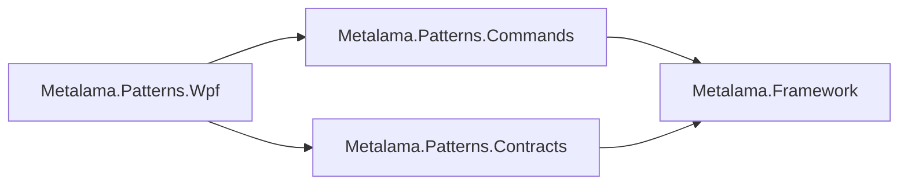

# Splitting the commands out of Metalama.Patterns.Wpf

This document proposes to move the `[Command]` aspect and the delegate command classes from `Metalama.Patterns.Wpf`
into a new package, `Metalama.Patterns.Commands`, that has no dependency on a user interface framework. The new
package can then be used with WPF, Avalonia, .NET MAUI and Windows Forms, and from view-model libraries that target
`netstandard2.0`. It is a design proposal for the 2027.0 version line. Nothing described here is implemented. The
file and line references describe `develop/2027.0` in October 2026, with paths relative to `Metalama.Patterns/src/`
unless stated otherwise.

## 1. Scope

The change has one goal: make the commands usable outside of WPF.

In scope:

- A new package, `Metalama.Patterns.Commands`, that contains the command run-time types, the `[Command]` aspect, its
  options and its naming conventions.
- The naming-convention infrastructure, which the commands and the dependency properties share, moves to the new
  package as internal code.
- `Metalama.Patterns.Wpf` keeps the `[DependencyProperty]` aspect and depends on the new package.

Out of scope:

- Dependency property aspects for Avalonia (`StyledProperty`, `DirectProperty`), .NET MAUI (`BindableProperty`) or
  any other framework. The number of downloads of `Metalama.Patterns.Wpf` does not justify them. The design keeps
  them possible but does not prepare an abstraction for them.
- An aspect for the property conventions of Windows Forms controls (`XxxChanged` events, `ShouldSerializeXxx`).
- The compile-time topology (`Redist` and `CompileTime` packages). Section 10 explains how the new package maps onto
  it later.

## 2. Current state

`Metalama.Patterns.Wpf` is one assembly that targets `net472;net10.0-windows` with `UseWPF` and
`EnableWindowsTargeting` (`Metalama.Patterns.Wpf/Metalama.Patterns.Wpf.csproj:4,18`). It references
`Metalama.Framework` and `Metalama.Patterns.Contracts`.

The command code does not use any WPF type:

- The command classes implement `System.Windows.Input.ICommand`. Despite its namespace, this interface is defined
  in `System.ObjectModel` on .NET and .NET Standard, and in `System.dll` on .NET Framework 4.5 and later. WPF,
  Avalonia, .NET MAUI and Windows Forms bind to the same interface.
- `BaseDelegateCommand` captures `SynchronizationContext.Current` in its constructors
  (`Metalama.Patterns.Wpf/BaseDelegateCommand.cs:45,52`) and posts its notifications to it
  (`Metalama.Patterns.Wpf/BaseDelegateCommand.cs:73-84`). It does not use `Dispatcher` or
  `CommandManager.RequerySuggested`.
- The run-time command code uses no reflection.
- The command unit tests (`tests/Metalama.Patterns.Wpf.UnitTests/Command/`) use only `ICommand` and
  `INotifyPropertyChanged`.

Only the `[DependencyProperty]` aspect uses WPF: `DependencyObject`, `DependencyProperty`, `DependencyPropertyKey`,
`PropertyMetadata`, `PropertyChangedCallback` and `CoerceValueCallback`. Only this aspect uses
`Metalama.Patterns.Contracts`.

The naming-convention infrastructure (`Metalama.Patterns.Wpf/Implementation/NamingConvention/`, 17 files) is used by
both aspects. So are diagnostics LAMA5203 to LAMA5207, which report naming-convention conflicts, and the
`Suppressions` and `StringHelper` helpers.

## 3. Target layout

### 3.1. Metalama.Patterns.Commands

| Kind | Content |
|---|---|
| Run-time types | `BaseDelegateCommand`, `DelegateCommand`, `DelegateCommand<T>`, `BaseAsyncDelegateCommand`, `AsyncDelegateCommand`, `AsyncDelegateCommand<T>`, `IAsyncCommand`, `DelegateCommandExecution`, `DelegateCommandFactory` |
| Aspect | `CommandAttribute`, `CommandAttribute.DiagnosticReporter` |
| Configuration | `CommandOptions`, `CommandOptionsBuilder`, `CommandExtensions` (`ConfigureCommand`), `CommandNamingConvention` |
| Command naming conventions | `Implementation/CommandNamingConvention/*` |
| Shared internal code | `Implementation/NamingConvention/*`, `Diagnostics`, `Suppressions`, `StringHelper`, `FormattingExtensions` |
| Assembly attributes | The `AspectOrder` that orders `[Observable]` before `[Command]` |

The package references `Metalama.Framework` only. It declares
`<InternalsVisibleTo Include="Metalama.Patterns.Wpf" />` so that the dependency property aspect keeps using the
shared internal code. The test projects that need internal access are added the same way.

### 3.2. Metalama.Patterns.Wpf

| Kind | Content |
|---|---|
| Aspect | `DependencyPropertyAttribute` |
| Configuration | `DependencyPropertyOptions`, `DependencyPropertyOptionsBuilder`, `DependencyPropertyExtensions`, `DependencyPropertyNamingConvention` |
| Implementation | `DependencyPropertyAspectBuilder` (all partial files), `DependencyPropertyAssets`, `Implementation/DependencyPropertyNamingConvention/*`, `ChangeHandlerSignatureKind`, `ValidationHandlerSignatureKind` |
| Assembly attributes | The `AspectOrder` that orders contracts around `[DependencyProperty]` |

The package references `Metalama.Patterns.Commands` and `Metalama.Patterns.Contracts`. A WPF user who references
`Metalama.Patterns.Wpf` therefore still receives the commands, with no change to the package references.

### 3.3. Package dependencies

The shared internal code stays in `Metalama.Patterns.Commands` instead of a separate package. It is internal, it is
used by only two packages, and every user of `Metalama.Patterns.Wpf` receives `Metalama.Patterns.Commands` anyway. A
separate package would add one more package to build, version and publish for code that no user sees.

## 4. Namespaces and compatibility

Decision: the public command types move from the `Metalama.Patterns.Wpf` and `Metalama.Patterns.Wpf.Configuration`
namespaces to `Metalama.Patterns.Commands` and `Metalama.Patterns.Commands.Configuration`. `Metalama.Patterns.Wpf`
contains no type forwarders for them. The internal code moves to `Metalama.Patterns.Commands.Implementation` and its
child namespaces.

This decision breaks source and binary compatibility:

- A WPF project that uses `[Command]` must add `using Metalama.Patterns.Commands;`. The package references do not
  change.
- An assembly that was compiled with an earlier version contains woven calls to
  `Metalama.Patterns.Wpf.DelegateCommandFactory`. It must be recompiled. This affects only libraries that are
  distributed in binary form, because an application is recompiled together with its dependencies.

The break is listed in the release notes of 2027.0, with the `using` directive as the migration step.

The alternative was to keep the `Metalama.Patterns.Wpf` namespaces in the new assembly and to add
`[TypeForwardedTo]` attributes to `Metalama.Patterns.Wpf`. A type forwarder requires the same full name, so this
alternative was the only way to keep binary compatibility. It was rejected because its cost is permanent: every
Avalonia, .NET MAUI or Windows Forms user would write `using Metalama.Patterns.Wpf;` to use commands. 2027.0 is a
major version that already contains breaking changes to the package topology.

The diagnostic IDs do not change (section 6), so suppressions in user code keep working.

## 5. Target frameworks and trimming

`Metalama.Patterns.Commands` targets `net472;net10.0;netstandard2.0`, like the other pattern libraries. It does not
set `UseWPF` or `EnableWindowsTargeting`.

The project sets `<IsTrimmable>true</IsTrimmable>` and `<IsAotCompatible>true</IsAotCompatible>` for the `net10.0`
target. .NET MAUI applications on iOS are compiled ahead of time, and .NET MAUI applications on Android and iOS are
trimmed. The analyzers that these properties enable report any incompatible construct at build time. No pattern
library sets these properties today, so the check must also cover the run-time Metalama assemblies that the woven
code of the commands references.

`Metalama.Patterns.Wpf` keeps `net472;net10.0-windows`.

## 6. Diagnostics

`Implementation/Diagnostics.cs` defines eight diagnostics, and all of them move to `Metalama.Patterns.Commands` with
their IDs unchanged:

| ID | Used by |
|---|---|
| LAMA5201, LAMA5202, LAMA5208 | `[Command]` |
| LAMA5203 to LAMA5207 | The naming-convention infrastructure, for both aspects |

The diagnostics that are specific to dependency properties are reported through the naming-convention
infrastructure, so `Metalama.Patterns.Wpf` keeps no diagnostic definition of its own.

`Metalama.Patterns/DiagnosticIds.md` lists only Contracts and Caching. The range 5200 to 5220 is added for
`Metalama.Patterns.Commands` and `Metalama.Patterns.Wpf`.

## 7. Capturing the synchronization context

`BaseDelegateCommand` captures `SynchronizationContext.Current` when the command is constructed. When no context is
present, notifications run synchronously on the thread that raises them.

This is a defect for Windows Forms. Windows Forms installs `WindowsFormsSynchronizationContext` only when the first
control is created on the user interface thread. A view model that is created before the first form captures no
context. When an asynchronous command completes on a thread-pool thread, the `CanExecuteChanged` handler of the
bound button then sets `Enabled` from that thread. Windows Forms throws an `InvalidOperationException` for this
cross-thread access when `Control.CheckForIllegalCrossThreadCalls` is set, which is the default under a debugger.

The proposed fix captures the context when the first handler subscribes to `CanExecuteChanged` or to
`PropertyChanged`, if no context was captured in the constructor. A binding subscribes on the user interface
thread, so the context that is captured at this point is the correct one. The fix applies to all frameworks, does
not change the behavior when the constructor already captures a context, and is covered by a unit test that
constructs the command with no context and subscribes under a test synchronization context.

## 8. Aspect ordering

`Metalama.Patterns.Wpf/AspectOrder.cs` names the aspect types as strings, so moving `CommandAttribute` does not
cause a build error. The order between `ObservableAttribute` and `CommandAttribute` moves to
`Metalama.Patterns.Commands` with the new full name of `CommandAttribute`. The order between contracts and
`DependencyPropertyAttribute` stays in `Metalama.Patterns.Wpf`.

`Metalama.Patterns.Commands` does not reference `Metalama.Patterns.Observability`. The integration of `[Command]`
with `[Observable]` relies on `INotifyPropertyChanged` only.

## 9. Tests

| Today | After the split |
|---|---|
| `Metalama.Patterns.Wpf.AspectTests/CommandTests` | `Metalama.Patterns.Commands.AspectTests`, targeting `net10.0` |
| `Metalama.Patterns.Wpf.AspectTests/DependencyPropertyTests` | Stay in `Metalama.Patterns.Wpf.AspectTests` |
| `Metalama.Patterns.Wpf.UnitTests/Command` and `Assets/Command` | `Metalama.Patterns.Commands.UnitTests`, targeting `net472;net10.0` |
| `Metalama.Patterns.Wpf.UnitTests/DependencyProperty` and `Assets/DependencyProperty` | Stay in `Metalama.Patterns.Wpf.UnitTests` |
| `Metalama.Patterns.Wpf.CompileTimeTests` (`DefaultCommandNamingConventionTests`) | `Metalama.Patterns.Commands.CompileTimeTests` |

The expected outputs of the command aspect tests change only in the namespace of the referenced types. A test that
shows another change indicates a defect in the move.

The command tests no longer require Windows, so they can run on Linux build agents.

## 10. Relation to the compile-time topology

The compile-time topology ([compile-time projects](compile-time-projects.md) and the
[study for Metalama.Patterns](compile-time-projects-patterns-study.md)) splits each pattern library into an
`X.Redist`, an `X.CompileTime` and an unsuffixed `X` package. Section 2.6 of the study treats `Metalama.Patterns.Wpf`
as one library and describes the command classes as WPF types; this document corrects that description.

The split proposed here is compatible with that topology. When it is applied, `Metalama.Patterns.Commands.Redist`
holds the `[Command]` attribute as a plain attribute and the run-time command types, and
`Metalama.Patterns.Commands.CompileTime` holds the aspect, the options and the naming conventions.
`Metalama.Patterns.Wpf` follows the same pattern for `[DependencyProperty]`. The study must be updated to list
Commands as a separate library.

## 11. Build, packaging and documentation

- `Metalama.Patterns/Metalama.Patterns.sln`: add the new package and the three new test projects.
- `eng/src/Program.cs:159`: add `Metalama.Patterns.Commands.$(PackageVersion).nupkg` to the public artifacts.
- `Metalama.Framework/src/Metalama.Framework.Analyzers/WellKnownDurableTypes.cs:91`: the comment names
  `Metalama.Patterns.Wpf` as the owner of the naming conventions, and is updated.
- `Metalama.Patterns.Commands/README.md`: new. `Metalama.Patterns.Wpf/README.md`: restricted to dependency
  properties, with a reference to the new package.
- The XML documentation of the command types describes them as WPF commands, for example
  `Metalama.Patterns.Wpf/CommandAttribute.cs:27`. It is rewritten in neutral terms.
- `Metalama.Documentation`: the article `content/patterns/wpf/command.md` moves to a new section,
  `content/patterns/commands/`, with a short section on each supported framework. The samples move from
  `code/Metalama.Documentation.SampleCode.Wpf` to a new sample project that does not reference WPF.
  `content/api/patterns-api.md` lists the new package. The release notes of 2027.0 describe the break of section 4.

## 12. Open questions

1. Whether the change of section 7 is part of this work or a separate issue. It is small and it is required for
   correct behavior on Windows Forms, so this document recommends to include it.
2. Whether the trimming and ahead-of-time compilation properties of section 5 are checked on a .NET MAUI sample
   application for iOS before the release, or only through the analyzers.

## 13. Work plan

1. Create `Metalama.Patterns.Commands` and move the files of section 3.1 to the namespaces of section 4.
2. Make `Metalama.Patterns.Wpf` reference the new package, and verify that the dependency property aspect tests pass
   with no change to their expected outputs.
3. Split the test projects as described in section 9.
4. Implement the change of section 7 with its unit test.
5. Update the build, the packaging and the README files (section 11).
6. Update the conceptual documentation and the samples in `Metalama.Documentation`.
