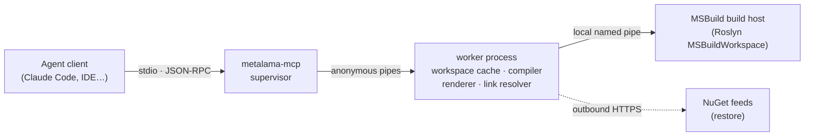
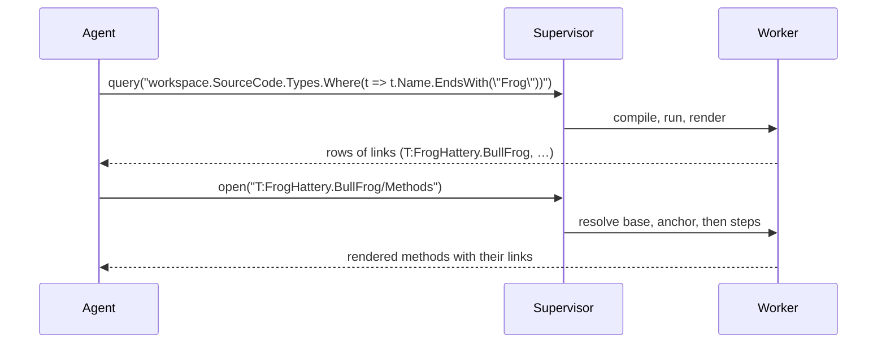

# Metalama MCP server

This document proposes a local MCP server that lets coding agents explore C# code with LINQ queries against the
Metalama code model, the way the `Metalama.LinqPad` driver does for people. The server runs arbitrary C# on purpose,
so it talks only over stdio and never opens a listening socket. It is a design proposal. Nothing described here is
implemented.

## 1. Goals and non-goals

### 1.1. Goals

- Let an agent load a project or solution once and then run many C# queries against `Workspace`, `SourceCode`,
  `TransformedCode`, aspect instances, diagnostics and metrics.
- Return results in a compact text form that fits in an agent's context, with explicit truncation.
- Make every printed object navigable through a link that the server can resolve again with no memory table.
- Expose the transport to the local client process only: stdio, no listening ports, enforced by the build.
- Run on Windows and Linux, including the Linux containers used for unattended agent work. The LINQPad driver is
  Windows-only because of WPF.
- Share the object walker and the link builder with `Metalama.LinqPad`, so both show the same properties and links.
- Let a person look at any result in a browser, laid out as LINQPad lays it out, with property tables and grids that
  can be expanded, sorted and filtered.

### 1.2. Non-goals

- **Sandboxing.** The server runs code with the user's privileges, as the agent's shell does. It does not try to
  limit what a query can do.
- **Remote access.** There is no HTTP, SSE or WebSocket transport, not even behind an opt-in flag.
- **Editing code.** The agent edits files with its own tools and calls `reload_workspace`.
- **Pre-built analysis tools** such as `find_type`. C# is the query language. We add sugar only after watching agents
  struggle without it.

## 2. Starting point: the LINQPad driver

`Metalama.LinqPad` already contains most of the logic. The server keeps it and replaces the LINQPad user interface.

| Driver piece | What it does | In the MCP server |
|---|---|---|
| `MetalamaWorkspaceDataContext` | Loads `workspace` with `WorkspaceCollection.Default.Load(path)`. | The `workspace` global of a query. |
| `DriverInitialization` | Starts Backstage without licence enforcement, registers metrics, routes `DiagnosticReporter`. | Same, with its own application info and headless settings. |
| `GetNamespacesToAdd`, `GetAssembliesToAdd` | Imports and references for queries. | Reused unchanged. |
| `FacadeObjectFactory`, `FacadeType` | Discover an object's public-interface properties, including lazy ones. | Moved to a shared project, then rendered as text. |
| `FacadePropertyFormatter` | Formats values as LINQPad view objects. | Split: a shared value classifier, plus one renderer per front end. |
| `Permalink` | Turns a declaration into a `workspace.GetDeclaration(…)` hyperlink. | Generalized into the link builder of section 8. |

## 3. Architecture



No component listens on a TCP port. The dotted edge is an outbound connection made by restore, not a listener.

### 3.1. Supervisor and worker

The server runs as two processes.

- **The supervisor** speaks MCP on stdio. It holds no workspace and runs no user code, so it is small and stays up for
  the whole session.
- **The worker** loads workspaces, compiles and runs queries, renders results and resolves links. It talks to the
  supervisor over a pair of `AnonymousPipeServerStream` handles passed on its command line. Those pipes have no name
  and no address.

The split solves two problems that an in-process design cannot:

1. **Runaway queries.** A tight loop cannot be cancelled cooperatively. The supervisor kills the worker after a hard
   timeout and starts a new one. The MCP connection survives; only the loaded workspaces are lost, and the next call
   reloads them.
2. **Stdout corruption.** In a single process, a query's `Console.WriteLine` would write into the JSON-RPC stream. In
   the worker, the console is redirected to a capture buffer that is returned with the result, and the RPC channel is
   a separate pipe.

### 3.2. Packaging

- A separate dotnet tool, `Metalama.Mcp`, with the command `metalama-mcp`, next to `Metalama.LinqPad` in the Metalama
  repository.
- It is not a subcommand of `Metalama.Tool`. That tool is deliberately light and does not reference Workspaces,
  MSBuild or the compiler.
- Target framework `net10.0`, without `-windows`.
- Registration: `claude mcp add metalama -- dnx Metalama.Mcp`, or the equivalent `dotnet tool run` command in other
  clients.
- The worker initializes Backstage as `DriverInitialization` does, with a `Metalama.Mcp` application info and no
  licence enforcement.

## 4. Security model

The server executes arbitrary code, by design, with the same privileges as the agent's shell. The only protection is
that nothing but the local client process can reach it. The documentation says so plainly and never calls it a
sandbox.

### 4.1. No listening sockets, enforced

- The only transport is stdio. The server has no `--port`, `--http` or similar option.
- It references the `ModelContextProtocol` core package only, never `ModelContextProtocol.AspNetCore`.
- `Microsoft.CodeAnalysis.BannedApiAnalyzers` runs on both projects with a `BannedSymbols.txt` that bans
  `HttpListener`, `TcpListener`, `UdpClient`, `Socket.Bind`, `Socket.Listen`, `WebApplication` and `KestrelServer`.
- A test fails if any `Microsoft.AspNetCore.*` assembly appears in the dependency closure of the tool package.
- An integration test starts the server, loads the sample workspace, runs a query, and checks that the process tree
  owns no listening TCP or UDP socket.

The guarantee covers the server's own code. A query can open a socket, as any program the user runs can.

### 4.2. Threats that remain

- **Loading a workspace runs the target repository's code.** MSBuild evaluation runs its targets, and the Metalama
  pipeline runs its aspects and fabrics at compile time. Loading an untrusted repository is the same as building it.
- **Prompt injection from the analysed code.** String literals and comments can contain text aimed at the agent.
  This is the same risk as reading the files with the agent's own tools. The design neither adds to it nor reduces it.

### 4.3. Client-side gating

- `query`, `load_workspace` and `reload_workspace` carry `readOnlyHint: false`, so clients that ask permission for
  tool calls ask for these.
- Links with a query anchor run code when they are followed, so `open` is also declared as not read-only.

## 5. Tools and resources

| Tool | Arguments | Returns |
|---|---|---|
| `load_workspace` | `paths[]`, `properties?` | Workspace key, projects with target frameworks, summary of load diagnostics, default link base. |
| `reload_workspace` | `workspace?` | Same as `load_workspace`. Wraps `Workspace.Reload()`; used after the agent edits files. |
| `unload_workspace` | `workspace` | Frees memory. |
| `query` | `code`, `workspace?`, `maxItems?`, `maxDepth?`, `format?`, `timeoutSeconds?` | Rendered value, captured console output, query diagnostics. |
| `open` | `link`, `maxItems?`, `maxDepth?`, `format?` | The object the link points to, rendered like a query result. |

- **Resource template.** The server also declares `metalama://{+path}`. Clients that support resources follow links
  with `resources/read`. Both paths use the same resolver.
- **Resource links in results.** A `query` or `open` result that expands a single object also carries one
  `resource_link` item for it. Rows of a list stay as plain text, because one content item per row would cost far
  more than the text.
- **Primer.** The server's `instructions` field carries a short primer: the README examples, `SourceCode` versus
  `TransformedCode`, introspection collections, metrics, and how links work.
- **Formats.** `format` is `text` (the default, section 7), `json` (section 7.6) or `html` (section 9.3). With `html`,
  the result is written to a file and the tool returns its path and a short text summary, so the page never enters
  the agent's context.
- **No `reset` tool.** Queries are stateless (section 6.3), so there is nothing to reset.

## 6. Query execution

### 6.1. Shape of a query

A query is either a C# expression, whose value is rendered, or a block of statements that ends with `return`. This is
the LINQPad "C# Expression" and "C# Statements" pair.

```csharp
workspace.SourceCode.Methods
    .Where( m => m.Accessibility == Accessibility.Public && m.DeclaringType.Accessibility == Accessibility.Public )
    .GroupBy( m => m.DeclaringType.FullName )
    .OrderBy( g => g.Key )
```

### 6.2. Globals

| Name | Meaning |
|---|---|
| `workspace` | The workspace named by the `workspace` argument, or the only loaded one. |
| `workspaces` | All loaded workspaces, by key. |
| `D(id)`, `D<T>(id)` | Resolve a declaration ID in `workspace`. Optional `project`, `tfm` and `transformed` arguments disambiguate. |
| `Open(link)`, `Open<T>(link)` | Resolve any link, so a query can continue from something the agent was shown. |
| `ct` | A cancellation token that fires on the soft timeout. |

Imports and references are those of `GetNamespacesToAdd` and `GetAssembliesToAdd` in the LINQPad driver.

### 6.3. Stateless queries

Each query stands alone. Variables do not carry from one call to the next.

- Links (section 8) give the agent a way back to anything it has seen, which was the main reason for REPL state.
- Every query can be re-run on its own, which query-anchored links depend on.
- The query is wrapped in a generated class, compiled with `CSharpCompilation`, and loaded into a collectible
  `AssemblyLoadContext`. Metalama assemblies resolve from the default context. Unloading the context after each query
  avoids the leak of non-collectible scripting submissions.
- Compiled queries are cached by a hash of their text. Following a query-anchored link compiles nothing new.

### 6.4. Limits

| Limit | Default | Effect |
|---|---|---|
| Soft timeout | 60 s | Cancels `ct`; the query should stop. |
| Hard timeout | 2 × soft | The supervisor kills the worker and returns an error that says the workspaces will reload. |
| `maxItems` | 50 | Items shown per collection. |
| `maxDepth` | 1 | Levels of properties expanded below the result. |
| Response size | 20,000 characters | Rendering stops with an explicit truncation line. |

The worker runs one query at a time. Calls queue in the supervisor.

## 7. Output format

The default format is an indented outline. Each object's line starts with its link, so the agent sees what it can
follow. Source locations are paths relative to the workspace root, which the agent opens with its own file tools.
The examples in this section are illustrative; property names and values come from the facade walker.

### 7.1. A list of declarations

```text
base: metalama://FrogHattery.sln/FrogHattery@net8.0/source/
IEnumerable<IMethod> — 3 items
M:FrogHattery.BullFrog.Croak                    BullFrog.cs:20
M:FrogHattery.BullFrog.Jump(System.Int32)        BullFrog.cs:31
M:FrogHattery.BullFrog.#ctor(System.String)      BullFrog.cs:14
```

### 7.2. A single object

The header gives the C# expression that resolves the object, which the agent can paste into a query. Nested
collections show their size and the link that opens them.

```text
D<INamedType>("T:FrogHattery.BullFrog")        BullFrog.cs:12
  Accessibility   Public
  IsSealed        false
  BaseType        T:FrogHattery.Frog
  Methods         [3]   → T:FrogHattery.BullFrog/Methods
  Properties      [2]   → T:FrogHattery.BullFrog/Properties
  Attributes      []
```

### 7.3. A projection

When every item is an anonymous type or record of scalars, the result is an aligned table. This is the shape agents
produce most.

```text
IEnumerable<{ Name, Complexity }> — 120 items, showing 50
Name                 Complexity
Frog.Jump            12
BullFrog.Croak        9
…
truncated: 50 of 120 shown; append .Skip(50) or pass maxItems
```

### 7.4. Rendering rules

| Value | Rendering |
|---|---|
| Declaration | Its link (the ID, relative to the base), then `file:line`. |
| Grouping | A key line, with the group's items indented below it. |
| Nested collection | `[count]` and the link that opens it. Expanded only within `maxDepth`. |
| Lazy or expensive property | `[?]` and a link. Nothing is computed until the agent opens it. |
| Getter that throws | `‹error: NotSupportedException›`; rendering continues. |
| Diagnostic | `error LAMA0041 BullFrog.cs:20 message`, with words rather than LINQPad's glyphs. |
| Transformed-code declaration | Suffix `[transformed]`. |
| Null, empty | `null`, `[]`. |

### 7.5. Response envelope

```text
<rendered value>
--- console ---              only when the query wrote to the console
--- query diagnostics ---    only on compile errors or warnings; positions are relative to the agent's code
--- 312 ms · fingerprint 3f9a… · truncated at 20,000 characters ---
```

### 7.6. JSON

With `format: "json"`, the same tree is returned as JSON for agents that post-process results.

```json
{ "link": "T:FrogHattery.BullFrog", "type": "INamedType", "location": "BullFrog.cs:12",
  "properties": {
    "BaseType": { "link": "T:FrogHattery.Frog" },
    "Methods":  { "link": "T:FrogHattery.BullFrog/Methods", "count": 3 } } }
```

The JSON form is also the only input of the HTML viewer (section 9). It is therefore a documented, versioned schema
(`"schema": 1` at the root), not an implementation detail of the renderer.

## 8. Links

A link names a stable anchor and a path of steps from it. The server resolves it again from nothing, so it keeps no
table of handles. Links survive reloads and process restarts, and an agent can paste them into notes or issues.

### 8.1. Anchors

From most to least stable:

| Anchor | Example | Source |
|---|---|---|
| Declaration | `T:FrogHattery.BullFrog`, `M:FrogHattery.Frog.Jump(System.Int32);Parameter=0` | `SerializableDeclarationId`: a documentation-comment ID extended with `;Parameter=`, `;TypeParameter=`, `;Return`, accessor kinds, `;PrimaryConstructor` and `;File=` for file-local types. |
| Type | `Y:…` | `SerializableTypeId`, for constructed types such as `List<Frog>` or `int?`. |
| Assembly | `Assembly:FrogHattery, Version=…` | `SerializableDeclarationId`. |
| Collection | `projects`, `aspect-classes`, `aspect-instances`, `transformations`, `diagnostics` | Collections of a workspace or project. |
| Query | `query/<base64url of the code>` | The result of running the code. |

ID resolution walks the merged global namespace, so declaration anchors reach referenced assemblies as well as source
code.

### 8.2. Steps

| Step | Applies to | Meaning |
|---|---|---|
| `<Property>` | Any object | A public-interface property, from the same set the facade walker shows (section 10.1). A hidden property is not a valid step. |
| `<n>` | Any collection | Zero-based position in enumeration order. Fragile. |
| `aspects/<AspectClass>[/<n>]` | Declaration | Aspect instances that target the declaration, by aspect class full name; `n` only when there are several. |
| `diagnostics/<Id>[/<n>]` | Declaration, project, workspace | Diagnostics by ID, then by position. |
| `inbound-references`, `outbound-references` | Declaration | `GetInboundReferences()`, `GetOutboundReferences()`. |
| `derived-types` | Named type | `GetDerivedTypes()`. |

Key steps are defined type by type in a small static table in the link builder. Adding one is a code change, not
runtime state.

### 8.3. Grammar

```text
metalama://<workspace>/<scope>/<code>/<anchor>[/<step>]*[?v=<fingerprint>]
metalama://<workspace>/query/<base64url>[/<step>]*?v=<fingerprint>

<workspace>  loaded path relative to the server's working directory, percent-encoded
<scope>      <project>@<tfm>, or ~ for the whole workspace
<code>       source | transformed
```

```text
metalama://FrogHattery.sln/FrogHattery@net8.0/source/T:FrogHattery.BullFrog
metalama://FrogHattery.sln/FrogHattery@net8.0/source/T:FrogHattery.BullFrog/Methods
metalama://FrogHattery.sln/FrogHattery@net8.0/source/M:FrogHattery.BullFrog.Croak/aspects/FrogHattery.LogAttribute/Advice/0?v=3f9a…
metalama://FrogHattery.sln/~/source/diagnostics/LAMA0041/0?v=3f9a…
metalama://FrogHattery.sln/query/d29ya3NwYWNlLlNvdXJjZUNvZGU…/12/DeclaringType?v=3f9a…
```

MSBuild properties used to load the workspace, such as `Configuration`, go in the query string.

### 8.4. Canonical form

The renderer always emits the shortest link: the nearest stable anchor, then the remaining steps. An object that is a
declaration collapses to its own ID. The renderer never prints `…/T:FrogHattery.BullFrog/BaseType`; it prints
`T:FrogHattery.Frog`.

### 8.5. Relative links

- Each response states a `base`, and rows use links relative to it, as HTML does with `<base href>`. The rows stay
  short.
- The server resolves relative links against the workspace's default base: its only project and target framework,
  with source code. A row becomes absolute only when that would be ambiguous, for example when a result mixes target
  frameworks.

### 8.6. Encoding

- Doc IDs contain `#` (`#ctor`), `{`, `}`, backticks and, in file-local IDs, `<` and `>`.
- **Absolute links**, in `resource_link` items, are percent-encoded so they are valid URIs.
- **Relative links in text rows** are printed raw, which is easier to read and cheaper in tokens.
- **The resolver decodes leniently** and accepts both forms, because agents type `#ctor` unencoded.

### 8.7. Staleness

- **Stable links** (a declaration, type or assembly anchor followed by property and key steps only) carry no version.
  They stay valid across edits until the declaration disappears, and then resolve to "not found".
- **Fragile links** (any index step, or a query anchor) carry `?v=`, a fingerprint of the workspace's compilation
  inputs: source text checksums, reference identities and compilation options.
- When a fragile link's fingerprint no longer matches, the server answers
  `stale: the workspace changed since this link was produced; re-run the query`. It never returns a different object
  silently.

### 8.8. Following a link



Resolution reads the scope and the code version, resolves the anchor (ID lookup, a collection, or a re-run of the
cached query), checks the fingerprint for fragile links, then applies the steps one by one.

### 8.9. Links in C#

`Open<T>(link)` resolves any link inside a query, so the agent can continue with LINQ from anything it was shown.
Declarations also have the shorter `D<T>(id)`.

```csharp
Open<IIntrospectionAspectInstance>( "M:FrogHattery.BullFrog.Croak/aspects/FrogHattery.LogAttribute" ).Advice
```

### 8.10. Query result cache

An LRU cache of query results, keyed by the query anchor and the fingerprint, saves re-running an expensive query on
every drill-down. It is an optimization only. With the cache empty, every link still resolves.

## 9. HTML viewer

The text format is for the agent. The viewer is for the person working with it: it shows a result the way LINQPad
does, so that a query the agent ran can be checked, browsed and shared.

### 9.1. One viewer, two ways to deliver it

The viewer is a single JavaScript page that renders the JSON format of section 7.6. The server never builds HTML
markup itself. The same page is delivered in two ways:

| | Static file (section 9.3) | MCP App (section 9.4) |
|---|---|---|
| Where it opens | Any browser, from `file://` | Inside the agent's host, next to the conversation |
| Data | A snapshot embedded in the file | The tool result, then more through `tools/call` |
| Drill-down beyond the data | Copy the link or the C# expression | Live, through the server |
| Needs | Nothing | A host that supports MCP Apps |

Neither way opens a socket. A local HTTP server and a custom `metalama:` protocol handler were both rejected: each
would need a listening endpoint that reaches the worker, which section 4 rules out.

### 9.2. Layouts

The layouts follow LINQPad's conventions.

| Value | Layout |
|---|---|
| Single object | **Property table**: a header bar with the type name and the link, then one row per property, name and value. |
| Collection of objects | **Grid**: a header bar with the item type and the count, one column per property of the item type, one row per item. |
| Projection (anonymous types, records) | Grid whose columns are the projection's members. |
| Collection of scalars | Single-column list. |
| Grouping | One collapsible section per key, with a grid inside. |
| Declaration in a cell | Its display string as a link, with `file:line` in muted text. |
| Nested object or collection in a cell | Collapsed to its summary (`[3]`, display string); a click expands it in place as a nested table. |
| Null, error | Grey `null`; red error text. |
| Truncated collection | A footer row: `50 of 120 shown`. |

Interactions:

- Expand and collapse any table by its header bar.
- Sort a grid by a column, filter it by text, and hide columns.
- On every row with a link, copy the link (to paste to the agent) or the C# expression (to paste into a query, or
  into LINQPad, whose `Open(…)` uses the same resolver).
- Light and dark themes follow the browser setting.

### 9.3. Static file

- `query` or `open` with `format: "html"` writes one self-contained HTML file and returns its path as a `file://`
  URI, together with the usual text summary.
- The file contains the viewer's script and styles inline and the result as JSON in a
  `<script type="application/json">` element. It loads nothing from the network.
- There is no round trip to the server, so the snapshot is rendered deeper than text output: by default `maxDepth` 3
  and `maxItems` 500, with a size cap of 10 MB.
- Links that point into the snapshot jump to the anchor in the page. Other links offer the two copy actions of
  section 9.2.
- Files go to the directory given by the `--output-dir` option, or by default to
  `<temp>/metalama-mcp/<workspace key>/`, with a name built from the time and a hash of the query.
- The server does not start a browser. The agent or the person opens the file.

### 9.4. MCP App

The MCP Apps extension (SEP-1865, stable since 2026-01-26) lets a server provide an HTML view that the host renders in
a sandboxed frame. The view and the server talk through the host with JSON-RPC over `postMessage`, so it fits the
transport rules of section 4.

- The server declares the resource `ui://metalama/viewer`, with MIME type `text/html;profile=mcp-app`. It is the same
  page as the static file, without embedded data.
- `query` and `open` declare `_meta.ui.resourceUri: "ui://metalama/viewer"`. Their results carry the JSON in
  `structuredContent` for the view and the text format in `content` for the model.
- The host passes the result to the view with `ui/notifications/tool-result`.
- **Live drill-down.** A click on a link sends `tools/call` for `open` through the host. "Show more" on a truncated
  grid sends `open` again with a larger `maxItems`. Hosts reject calls from the view to tools whose `visibility`
  lacks `"app"`, so `query` and `open` declare `["model", "app"]`.
- The resource declares no `csp` domains, so the host applies the extension's restrictive default and the view has
  no network access.
- The server registers the view only when the client advertises the `io.modelcontextprotocol/ui` capability. Other
  clients see text and JSON only.
- Following a query-anchored link runs code (section 4.3), so a host that asks permission for tool calls asks for
  calls made from the view too.

### 9.5. Untrusted content

Values come from the analysed code: string constants, attribute arguments, diagnostic messages. A crafted value must
not be able to run script in the viewer or send data anywhere.

- The viewer builds its DOM with `textContent` and attribute setters only, never `innerHTML`, and runs no `eval`.
- Links are rendered as in-page anchors or copy buttons, never as `href` values built from data.
- In the static file, the embedded JSON escapes `<` as `<`, so a value containing `</script>` cannot close the
  element.
- The static file sets a content security policy in a `<meta>` element: `default-src 'none'`, the viewer's script
  allowed by its hash, inline styles, and `data:` images.

### 9.6. Building the viewer

- The viewer is plain JavaScript with no framework, embedded as a resource in `Metalama.Mcp`, with a size target under
  100 KB.
- Writing it by hand avoids adding a Node.js build step to the repository. Section 13 asks whether that holds once
  the grid interactions are written.
- Its styling echoes LINQPad's: blue header bars, nested tables, muted nulls.

## 10. Code shared with LINQPad

- A new project, tentatively `Metalama.Framework.Workspaces.Navigation`, receives the facade walker
  (`FacadeObjectFactory`, `FacadeType`), the value classifier from `FacadePropertyFormatter`, and the link builder and
  resolver. It has no LINQPad or WPF dependency.
- `Metalama.LinqPad` keeps its HTML rendering and turns each link into a `Hyperlinq` that runs the `Open(…)`
  expression. Its current `Permalink`, which handles declarations only, is replaced by the general link builder.
- `Metalama.Mcp` adds the text and JSON renderers, the tools and the process split.
- Both front ends then show the same properties, in the same order, with the same links.

### 10.1. Display conventions

The Metalama API marks what tools should not show, and `FacadeType` encodes further rules. They move with the walker
into the shared project, so the text, JSON and HTML output honor them as LINQPad does.

| Convention | Effect today | Examples |
|---|---|---|
| `[Hidden]` on an interface (`Metalama.Framework.Utilities.HiddenAttribute`) | The interface counts as non-public, so none of its members are shown through it. | `ICompilationElement`, `IExpression`, `IObjectCreationExpression`, `IWorkspaceLoadInfo` |
| `[Hidden]` on a property or field | The member is skipped. | `ICompilation.Comparers`, `ICompilation.Cache`, `IDeclaration.Depth` |
| `[Obsolete]` on a property | The property is skipped. | |
| Public assemblies | Only interfaces from `Metalama.Framework`, `Metalama.Framework.Introspection`, `Metalama.Framework.Workspaces` and the core library contribute members. A type with no public base and no interface, such as an anonymous type, shows its own public properties. | |
| Getters only | Indexers and properties without a getter are skipped. | |
| Inline values | `null`, strings, primitives and collections are rendered as values, not as objects with properties. | |
| Property order | `PropertyComparer`: `Index` and `Id` first, then `Severity` and `Position`, `ShortName`, `Name` and `DisplayName`, `FullName`, then the rest; scalars before collections; then by name. In the HTML viewer, this is also the column order of a grid. | |
| `Permalink` | `FacadeType` adds a synthetic `Permalink` property to every declaration. | |

Changes in the shared walker:

- **`[Hidden]` and `[Obsolete]` on interface properties.** `FacadeType` checks both attributes only for properties
  found on a public base class. Code-model objects are internal classes reached through their public interfaces, so
  the check never runs for them, and `IDeclaration.Depth` appears to be shown despite `[Hidden]`. The shared walker
  checks the attributes on the interface property as well. This also changes what LINQPad shows.
- **`Permalink` becomes the link.** It is no longer a property: the text format prints the link at the start of the
  row, JSON has a `link` field, and LINQPad renders the same link as a hyperlink.

Hiding affects display only. A query can still read a hidden member, because C# sees the full API.

## 11. Testing

Tests use the existing `FrogHattery` sample from the LINQPad tests.

- **Round trip:** load, query, follow every link in the output, and check that each resolves to an equal object.
- **Link coverage:** for every declaration kind, including parameters, accessors, file-local types and declarations
  introduced by aspects, the canonical link exists and resolves. `Permalink` currently swallows exceptions from
  `ToSerializableId()`; this test finds those gaps.
- **Staleness:** after an edit and a reload, stable links still resolve and fragile links report stale.
- **Determinism:** enumerating each code-model collection twice, across two loads of identical sources, gives the
  same order.
- **Isolation:** a query that writes to the console does not corrupt the MCP stream, and its output comes back under
  `console`.
- **Timeouts:** an infinite loop is killed by the hard timeout, and the next call works.
- **Truncation:** the size and item limits apply and are reported.
- **No listeners:** the banned-API analyzer, the dependency-closure check, and the socket check on the running
  process tree.
- **JSON schema:** every JSON result validates against the published schema.
- **Display conventions:** the output never contains `Depth`, `Comparers` or `Cache`, nor members contributed by a
  `[Hidden]` interface, and an `open` link that names a hidden property is rejected. The same test runs against the
  LINQPad facade.
- **Viewer injection:** a sample whose string constants and attribute arguments contain `</script>`, HTML tags and
  event-handler attributes renders as plain text in the static file, and the page makes no network request.
- **Viewer smoke test:** a headless browser opens a static file of the sample, expands a nested table, sorts a grid,
  and reports no script error.

## 12. Phasing

**v1**

- Supervisor and worker, stdio only, with the enforcement checks.
- `load_workspace`, `reload_workspace`, `unload_workspace`, `query`, `open`.
- Text renderer, declaration anchors, property and index steps, fingerprints.
- JSON format and its schema, because the viewer depends on them.
- Static HTML viewer (section 9.3).
- Extraction of the shared project; LINQPad moves to the general link builder.

**v2**

- Query anchors and the result cache.
- Key steps: `aspects`, `diagnostics`, references, derived types.
- MCP App delivery of the viewer (section 9.4), resource template, `resource_link` items.
- Exploring compiled assemblies (section 13).

## 13. Open questions

1. **Compiled assemblies.** Workspaces load source projects. To explore a DLL or a NuGet package, `load_assembly`
   could generate a scratch project that references it and load that as a workspace. ID resolution already reaches
   referenced assemblies. Is this needed in v1?
2. **Query anchor encoding.** Base64url is compact but unreadable; percent-encoded C# is readable but noisy. This
   draft uses base64url, because agents follow these links rather than read them.
3. **Collection order.** Most code-model collections follow source order. Any backed by a hash set would need sorting
   in the renderer and resolver, or index steps could change between two identical loads. The determinism test will
   tell.
4. **Roslyn version.** Queries are compiled with the Roslyn version that the Metalama engine uses
   (`eng/RoslynVersions`). The worker must load that version, not the one shipped with the SDK.
5. **Headless Backstage.** Confirm that no welcome page, toast or browser launch can happen in the worker.
6. **Names.** `Metalama.Mcp` for the tool and `Metalama.Framework.Workspaces.Navigation` for the shared project are
   placeholders.
7. **Viewer toolchain.** Hand-written JavaScript keeps the build free of Node.js. Sortable, filterable nested grids
   may justify TypeScript and a bundler instead.
8. **MCP App in v1.** The static file works everywhere. The MCP App gives live drill-down but depends on host
   support. Should it move to v1?
